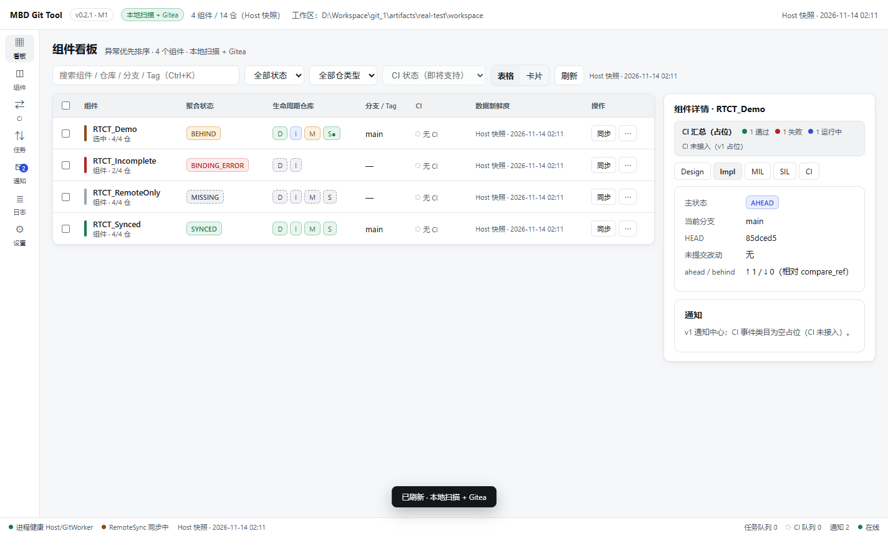
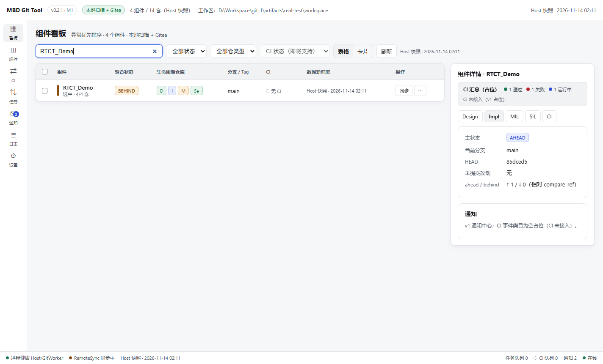
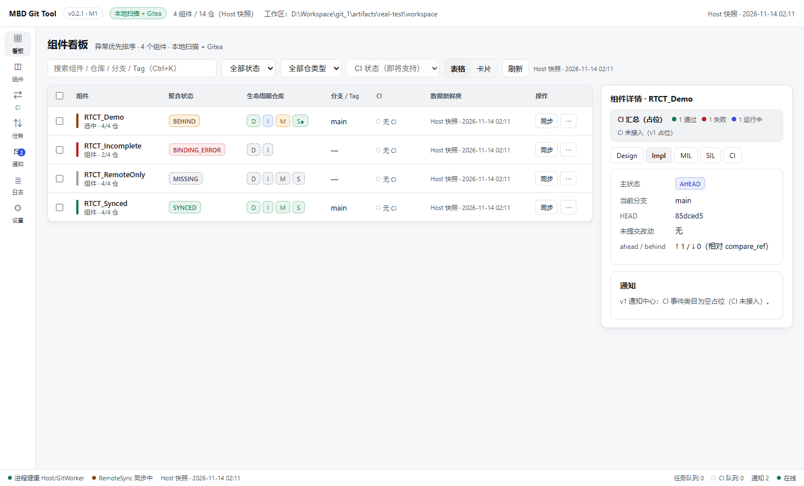
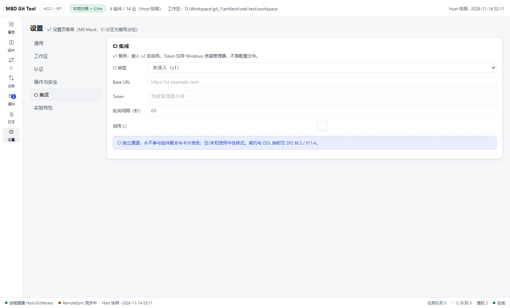

# 真实 Gitea 端到端测试记录（RTCRepos）

> 日期：2026-11-14　环境：`http://192.168.50.20:3000`（Gitea 1.25.5）
> 测试性质：真实 Gitea + 真实 git 提交 + 真实本地工作区 + 鼠标/键盘操作（CDP Input 事件）。
> **token 未写入仓库/文档/日志**；下方只记录 scope 结论。

## 1. 环境与权限结论

| 项 | 结果 |
|---|---|
| Gitea 版本 | 1.25.5 |
| 组织 | `RTCRepos`（私有，owner `trevn.wang`） |
| token A（首枚） | scope 仅 `write:repository`：`/user`、`/orgs/...` 403；不能列组织/建仓；但对 `TestRepo/SF104A_Component_*` 有 admin/push |
| token B（第二枚） | 可读取 `RTCRepos` 组织、可创建仓库，用于本次测试 |
| 建仓方式 | `POST /api/v1/orgs/RTCRepos/repos`（`auto_init=true`, `default_branch=main`） |

> 由于 token A 的 scope 限制，本次同时给 `GiteaClient` 增加了**所有者发现降级链** org → user → search（`fix(gitea)` 提交），使受限 PAT 环境也能只读发现仓库；RTCRepos 测试走 org 路径。

## 2. 创建的测试仓库（15 个，保留在 RTCRepos 供复查）

| 用途 | 仓库 |
|---|---|
| 状态混合组件 | `RTCT_Demo_Design/Impl/MIL/SIL` |
| 全同步组件 | `RTCT_Synced_Design/Impl/MIL/SIL` |
| 远程独有（本地不克隆） | `RTCT_RemoteOnly_Design/Impl/MIL/SIL` |
| 远程缺仓 | `RTCT_Incomplete_Design/Impl` |
| 未绑定命名 | `RTCT_Unbound_SIL_Design` |

## 3. 真实提交轮次（本地工作区 `artifacts/real-test/workspace`）

- 克隆 `RTCT_Demo_*` + `RTCT_Synced_*` 共 8 仓（HTTP + token，clone 后 remote URL 去掉 token）；
- **Round 1**：8 仓各新增 `component.txt` 并 push；
- **Round 2**：8 仓各改一行版本号并 push；
- **Round 3**：
  - `RTCT_Synced_*`、`RTCT_Demo_Design` → push（SYNCED）；
  - `RTCT_Demo_Impl` → 只本地 commit（AHEAD 1）；
  - `RTCT_Demo_MIL` → 临时克隆 push 后工作区 fetch（BEHIND 1）；
  - `RTCT_Demo_SIL` → 只改工作区不提交（DIRTY 1）。

## 4. 工具接入后的结果（预期 vs 实际）

启动方式（环境变量注入，不写配置文件）：

```powershell
$env:MBD_GITEA_URL   = 'http://192.168.50.20:3000'
$env:MBD_GITEA_ORG   = 'RTCRepos'
$env:MBD_GITEA_TOKEN = '<token>'
$env:MBD_WORKSPACE_ROOT = '<repo>\artifacts\real-test\workspace'
dotnet run --project src\MbdGitTool.Host
```

| 组件 | 远程/本地 | 预期 | 实际 | 明细（鼠标点开） |
|---|---|---|---|---|
| `RTCT_Demo` | 4/4 | BEHIND | ✅ **BEHIND** | D SYNCED / I AHEAD ↑1 / M BEHIND ↓1 / S DIRTY（S●） |
| `RTCT_Synced` | 4/4 | SYNCED | ✅ **SYNCED** | 四仓 SYNCED，工作区干净 |
| `RTCT_RemoteOnly` | 4/0 | MISSING | ✅ **MISSING** | 四仓本地均 MISSING |
| `RTCT_Incomplete` | 2/0 | BINDING_ERROR | ✅ **BINDING_ERROR** | 远程缺 MIL/SIL（INCOMPLETE，severity 12） |
| `RTCT_Unbound_SIL_Design` | — | 不绑定 | ✅ 仅日志告警 | 未进入组件列表 |

- 数据源徽标：`本地扫描 + Gitea`；标题栏显示 `4 组件 / 14 仓（Host 快照）` 与工作区路径；
- 刷新：鼠标点击 → `刷新中…` → Toast「已刷新 · 本地扫描 + Gitea」；
- 控制台：0 error / 0 exception；1440×900 无横向溢出。

## 5. 鼠标/键盘操作测试（CDP Input，非 JS click）

| # | 操作 | 结果 |
|---|---|---|
| 1 | 鼠标点搜索框 → 键盘输入 `RTCT_Demo` | 列表 4→1 行，首行 `RTCT_Demo` |
| 2 | 键盘 `Ctrl+A` + `Backspace` | 恢复 4 行 |
| 3 | 鼠标点 `RTCT_Demo` 行 | 详情面板切换；四仓 Tab 状态：Design SYNCED / Impl AHEAD(↑1) / MIL BEHIND(↓1) / SIL DIRTY(有改动) |
| 4 | 鼠标依次点导航 组件/CI/任务/通知/日志/设置 | 页面标题依次：组件列表 / CI 流水线 / 任务中心 / 通知中心 / 日志与诊断 / 设置 |
| 5 | 鼠标点设置 → CI 集成 | CI 分区（禁用占位）显示 |
| 6 | 鼠标点刷新 | `刷新中…` → 完成 Toast |
| 7 | 鼠标滚轮 | 看板内容不足一屏，无滚动（预期） |

## 6. 截图

| 截图 | 内容 |
|---|---|
|  | 4 组件 / 14 仓 / 数据源 `本地扫描 + Gitea` |
|  | 鼠标点搜索框 + 键盘输入过滤 |
|  | 四仓 Tab / ahead-behind |
|  | 设置 → CI 集成占位 |
|  | 鼠标刷新 + Toast |

## 7. 限制与说明

- 工具当前为 **M1 只读**：不对 Gitea/本地仓库执行写操作；提交由测试脚本用 git 完成。
- `RTCRepos` 测试仓库保留在服务器，可登录复核；本地工作区在 `artifacts/real-test/workspace`（gitignored）。
- token 未写入任何受版本管理文件；测试脚本在 `artifacts/real-test/`（gitignored），通过参数/环境变量注入。
- CI 未接（v1 占位）；远程 refs/fetch 巡检、三阶段首扫进度、GitWorker 管道仍属 M1-b。
