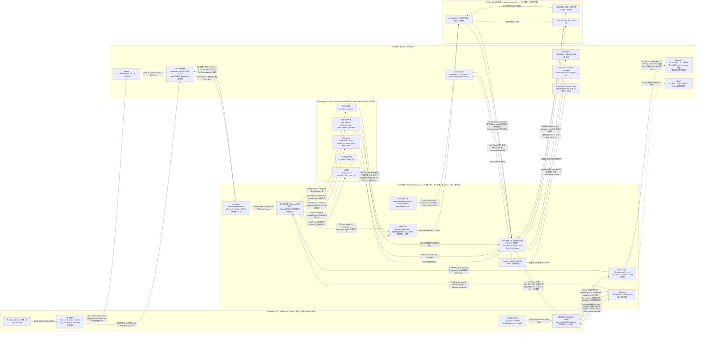
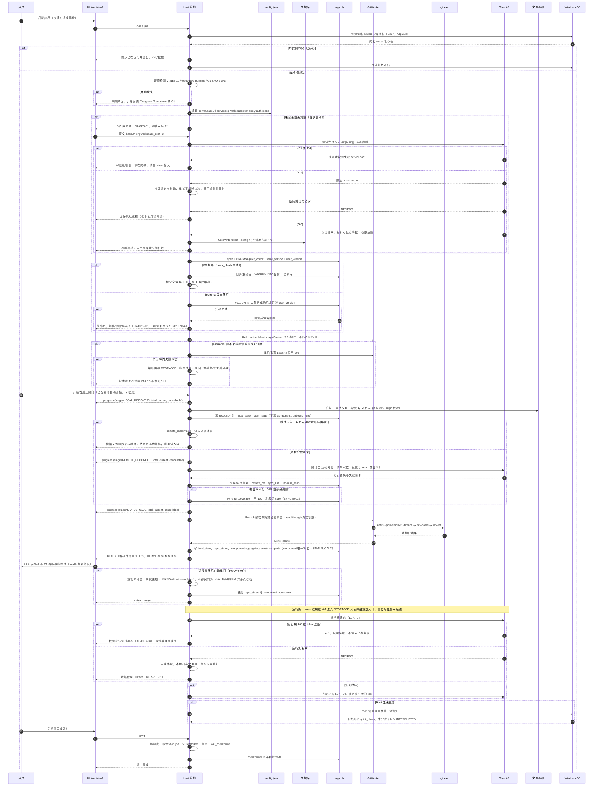
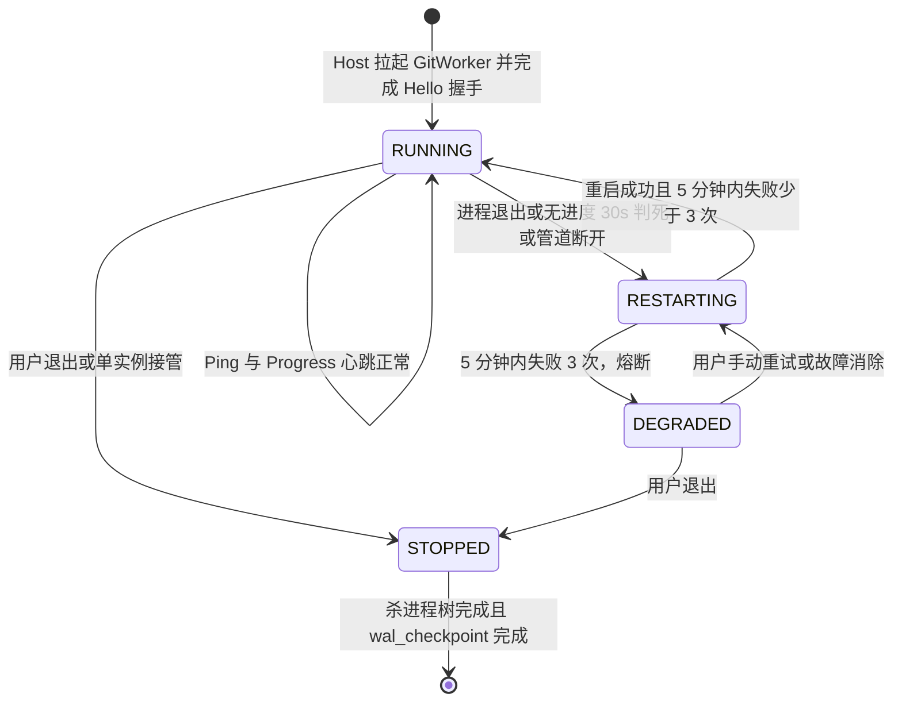
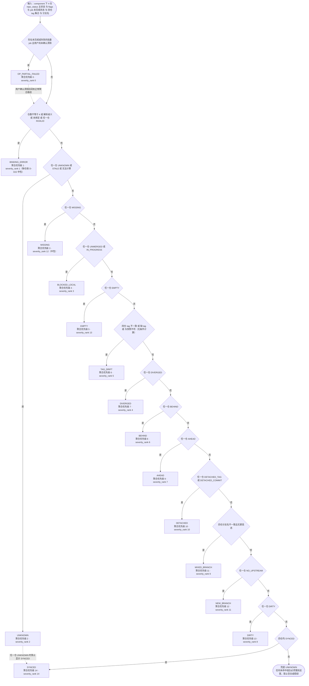
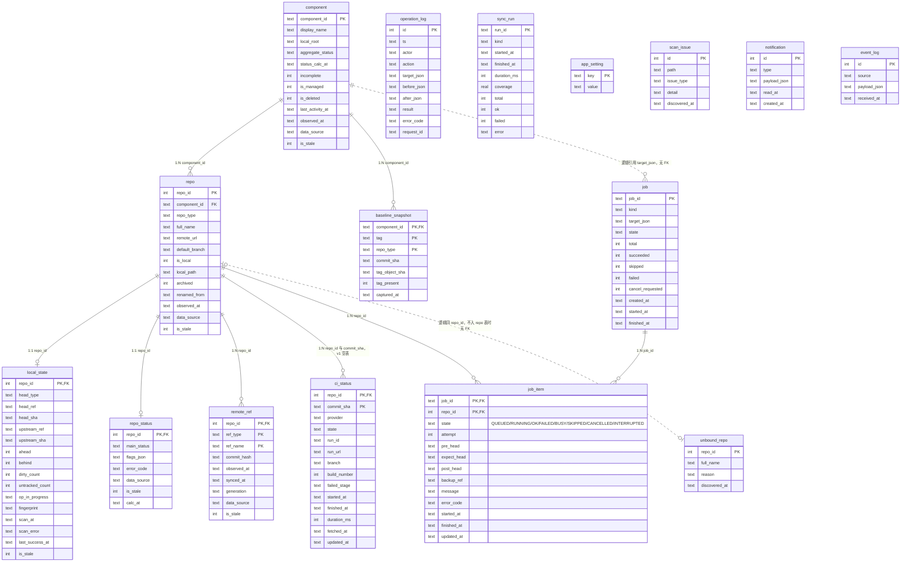
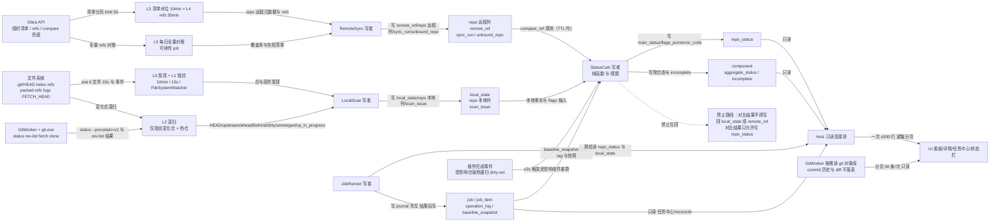
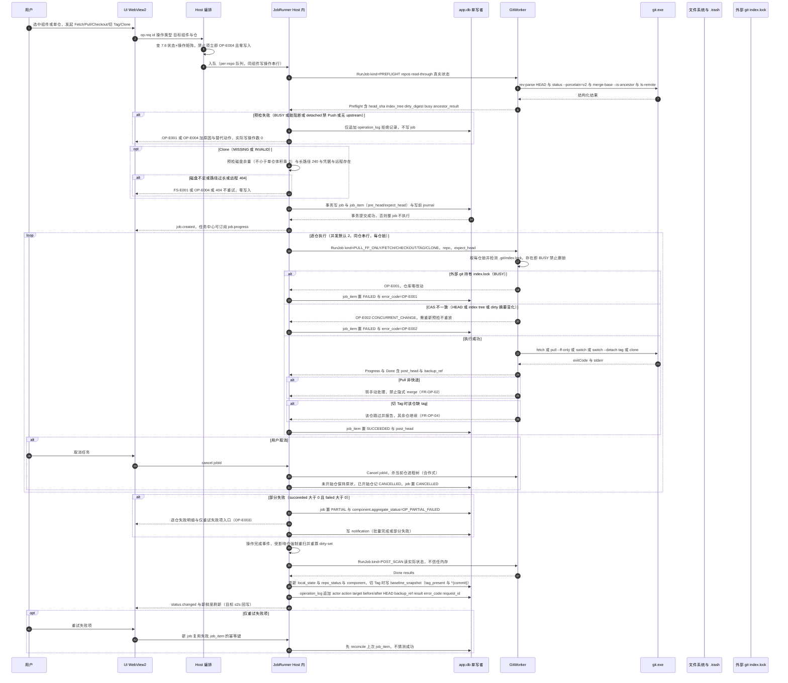
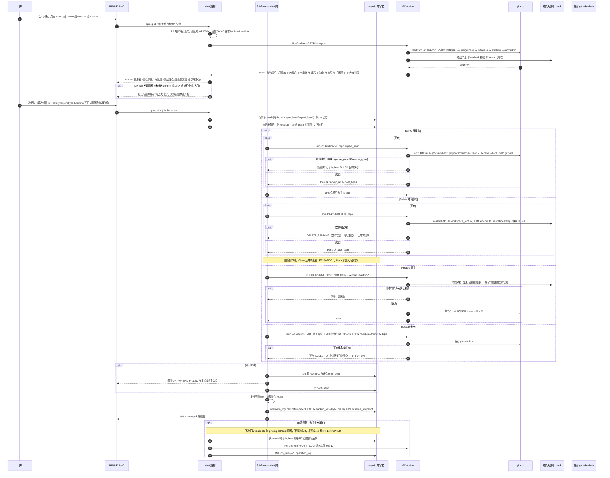
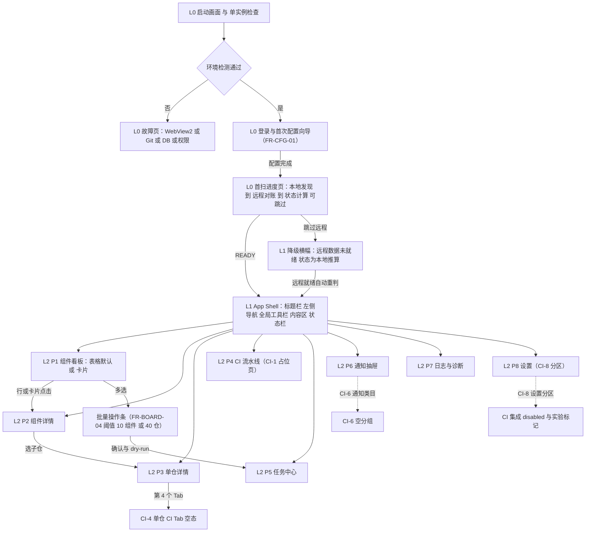

# MBD 组件全生命周期 Git 工具 — 执行图集 D1–D6（SRS v0.2.1 候选交付物）

> **文件性质**：本文件是 SRS v0.2.1 的**新增交付物**，只新增、不修改任何既有文件。`reqs/requirements.md`、原始 `.docx`/`.drawio`、`reqs/review/*` 均保持只读；文中出现的行号/§编号均指 SRS v0.2.1（章节与 v0.1.1 相同）。
> **修订依据（2026-11-14）**：按 `reqs/review/07-freeze-review.md` 独立冻结复评对齐 SRS v0.2.1——C-03 聚合顺序（`MISSING=3 / BLOCKED_LOCAL=4`）、M-01 D2 写者、H-01/H-02 首启中间态与阶段协议、H-03 D4 字段补齐、M-02 D5 操作数/内部协议、M-03 D6 CI 键数与健康灯、M-10 过时登记清理、M-13 诊断包清单、M-14 自检门禁、C-06 AC 新编号。**SRS 正文以 `requirements.md` 为准，本文只回写图集。**
> **目的**：把 SRS 变成 6 张**可据以实现、可据以写测试**的执行图。每张图必须满足：节点名与 SRS 枚举/表名/页面名逐字一致；失败/离线/部分失败/取消路径必须画出来；图后给"可检查验收标准"。
> **图语汇约定**：仅用 Mermaid（GitHub / VS Code 可直接渲染）+ 必要 ASCII。流程图节点 id 为 ASCII，显示名一律中文并引用 SRS 术语；状态图节点名 = SRS 7.2/7.4 枚举原名（`UNKNOWN`…`SYNCED`）；表名 = SRS 8.1 原名（`component`/`repo`/…）。
> **读者**：架构师（D1/D4）、宿主/平台实现（D2/D5）、领域状态机实现（D3）、前端/UX（D6）、QA（全部图后的验收标准）。
> **追溯口径**：FR ID、AC 编号、`CI-1`…`CI-10`、错误码前缀（`CFG/SYNC/SCAN/STATE/OP/FS/NET/GIT/SEC`）、设置键（附录 D）全部来自 SRS，不新增。

---

## 1. 图集总览

### 1.1 六张图、用途、owner 与里程碑

| 图 | 名称 | 回答的问题 | owner（角色） | 交付里程碑 | 主要 SRS 依据 |
|---|---|---|---|---|---|
| **D1** | 系统上下文与进程拓扑 | 有几个 OS 进程？各自读写哪些表、周期/超时/重试/失败动作/健康心跳是什么？谁唯一写 DB、谁唯一发 Gitea REST？ | 系统架构师（Host/GitWorker 负责人） | **M0**（`§3.3`：D1–D6 图集） | §12.1/§12.2/§12.4、FR-CFG-03/05、FR-SYNC-03/06、FR-SCAN-03/04/05、FR-OP-10、FR-OPS-02/04/08、NFR-REL-02 |
| **D2** | 启动/停止/异常生命周期时序 | 单入口到就绪的顺序是什么？三阶段首启何时可跳过？未登录/token 过期/401/403/429/断网/进程崩溃/重启退避+熔断/退出清理/单实例怎么走？ | 宿主与平台负责人 | **M0**（首启骨架+Mock）、M1 实测 | FR-CFG-01/04、FR-SYNC-03、FR-SCAN-01、FR-OPS-04/06/08、NFR-REL-01/02/03/04、AC-OPS-15/16、AC-CFG-08、AC-SAFE-08/09 |
| **D3** | 单仓状态机 + 组件聚合判定 | 单仓 14 主状态怎么判、怎么迁移？11 个正交标记怎么用？15 个组件聚合态的全序与 UNKNOWN 兜底是什么？ | 领域状态机负责人（Git 语义） | **M0**（状态矩阵夹具同步冻结） | §7.2/7.3/7.4/7.6、FR-STA-01…06、FR-REPO-05、FR-OP-04/05/07、附录 C |
| **D4** | 数据流与 ER | 16 张表的 PK/FK、写者/读者、新鲜度字段是什么？聚合读取关系？哪些写入被禁止？UI 查询如何限流？ | 数据层负责人 | **M0**（DDL/迁移基线） | §8.1/§8.2、§7.1/7.5、FR-SYNC-01/02/04/05、FR-SCAN-02/04、FR-STA-04、FR-OP-08/09、FR-OPS-06、FR-CI-05 |
| **D5** | 批量操作闭环时序 | 常规操作与破坏性操作从点击到看板刷新各步是什么？dry-run/确认/journal/部分失败/重扫/审计如何插入？BUSY/CAS/index.lock/取消如何处理？ | 批量操作与任务中心负责人 | **M2**（D5 在 M0 先冻结接口与失败模型） | §7.6、FR-OP-01…12、FR-SAFE-01/02/04、FR-REPO-01…05、AC-SYNC-14、AC-OP-15/16、AC-OP-20/21、AC-OP-03、AC-OP-11/12、AC-STA-15、AC-OP-24/25、AC-OP-30、AC-OP-29、AC-SAFE-08/09 |
| **D6** | UI 线框与数据绑定（含 CI 预留） | L0/L1/L2 页面结构？看板行/卡片绑定哪些字段、什么时候刷新？CI-1…CI-10 在哪儿、v1 空态是什么？状态栏 6 段/七种页面态？ | 前端/UX 负责人（QA 联合验收） | **M0**（锚点快照 + Mock） | §11.1–11.4、FR-BOARD-01…06、FR-DETAIL-01…05、FR-OPS-01/03/05、FR-CI-01…05、AC-CI-01…AC-CI-11、AC-BOARD-03/05/14、AC-BOARD-04/06/07、AC-BOARD-13、AC-CFG-08 |

### 1.2 D1–D6 ↔ FR / AC 映射表

| 图 | FR | AC |
|---|---|---|
| D1 | FR-CFG-03/05、FR-SYNC-01/02/03/06、FR-SCAN-03/04/05、FR-OP-10、FR-OPS-02/04/05/08、FR-CI-02/05 | AC-STA-04/09、AC-STA-05、AC-SAFE-12/13、AC-OPS-09/10、AC-CFG-08、AC-OP-29、AC-SAFE-08/09、AC-CI-01…AC-CI-11（契约侧） |
| D2 | FR-CFG-01/02/04、FR-SYNC-03、FR-SCAN-01/04、FR-STA-05、FR-OPS-04/06/08/09 | AC-OPS-15/16、AC-OPS-09/10、AC-OPS-16、AC-OPS-01…08/17、AC-CFG-08、AC-SAFE-08/09 |
| D3 | FR-STA-01/02/03/04/05/06、FR-REPO-05、FR-OP-04/05/07、FR-BOARD-01（排序） | AC-SYNC-01、AC-SYNC-14、AC-STA-01/02、AC-STA-04/09、AC-STA-05、AC-OP-11/12、AC-STA-15、AC-REPO-08…11、AC-OPS-16、AC-BOARD-04/06/07 |
| D4 | FR-SYNC-01/02/04/05、FR-SCAN-02/04/06、FR-STA-04、FR-OP-08/09、FR-OPS-06、FR-CI-05 | AC-CI-01…AC-CI-11、AC-SAFE-12/13、AC-OPS-01…08/17、AC-SAFE-08/09 |
| D5 | FR-OP-01…12、FR-SAFE-01/02/04、FR-REPO-01/02/03/05 | AC-SYNC-14、AC-OP-15/16、AC-OP-20/21、AC-OP-03、AC-OP-11/12、AC-STA-15、AC-OP-24/25、AC-REPO-08…11、AC-OP-30、AC-OP-31/32、AC-OP-29、AC-SAFE-08/09 |
| D6 | FR-BOARD-01…06、FR-DETAIL-01…05、FR-OPS-01/03/05、FR-CI-01…05 | AC-CI-01…AC-CI-11、AC-BOARD-03/05/14、AC-BOARD-04/06/07、AC-BOARD-13、AC-OPS-01…08/17、AC-CFG-08 |

> **AC 编号口径（C-06）**：本文只使用 `ac-catalog.md` §1.2/§3 的域前缀编号（`AC-<域>-<NN>`），**新编号唯一权威**；旧 27 条概览编号已作废，映射见 `ac-catalog.md` §1.4，本文不再引用。图集与 `freeze-checklist.md` §3 的 3.1–3.8 一一对应；每张图后的"验收标准"即 3.7/3.8 的证据。

### 1.3 图规模（节点 / 边 / 表项计数，供 QA 核对图集完整性）

| 图 | 结构规模 |
|---|---|
| D1 | Mermaid 流程图：**28 节点 / 42 边 / 5 个分区**（外部 8、Host 8、GitWorker 4、WebView2 3、SQLite 5 个表组）+ 进程卡 7 行 + 表写者/读者 16 行 |
| D2 | 主时序：**11 参与者 / 67 消息 / 14 个 alt-opt 块**；附监督状态机：**4 状态 / 9 迁移**；异常分支表 15 行 |
| D3 | 单仓状态机：**14 状态 / 48 迁移**；聚合判定：**32 节点 / 33 边**；flags 表 11 行；映射表 15 个聚合态 + 兜底 + 15 行测试锚点 |
| D4 | ER：**16 实体 / 10 关系 / 143 属性**（覆盖 SRS v0.2.1 §8.1 全列）；数据流：**21 节点 / 25 边**；16 表写者/读者/新鲜度表；UI 查询路径 8 行 |
| D5 | 常规时序：**9 参与者 / 43 消息**；破坏性时序：**9 参与者 / 40 消息**；操作覆盖矩阵 8 行；并发/取消/失败规则 7 行 |
| D6 | 页面路由：**19 节点 / 22 边**；ASCII 线框 **5 段**（覆盖 L0–L2 共 11 个页面或区域）；看板绑定表 17 行；CI 锚点 10 行；状态栏 6 行；页面态 7 行 |

> 规模口径：节点 = 可命名实体（进程/子系统/表组/状态/页面/参与决策项），边 = 数据流或消息或状态迁移；计数以本文件 Mermaid 源码为准，QA 可用渲染器节点数复核。

---

## 2. D1 系统上下文与进程拓扑

**用途**：冻结 v1 的 OS 进程数（2 个业务进程 + OS 管理的 WebView2）、每个进程的数据权限、外部依赖与失败策略。**本图回答"谁碰 DB、谁发 Gitea REST、git.exe 由谁执行"三个一票否决问题。**

### 2.1 五条不可违反的系统不变量（下表是图的校验口径，图内不重复文字）

| ID | 不变量 | SRS 依据 |
|---|---|---|
| I1 | **Host 是唯一 DB 写者**：仅 Host 持有可写连接；写命令一律经单写队列（Channel）由单写线程按 200ms 或 500 行批量提交；GitWorker 永不连库。 | §12.1、§12.3、§8.2 |
| I2 | **Host 是唯一 Gitea REST 客户端**：只有 RemoteSync 经 Host 的 HTTP 客户端发 `/orgs/{org}/repos`、refs、compare 兜底；GitWorker 只执行"含网络型 git 命令"（clone/fetch/pull/push），不解析、不写库。 | §12.1 网络边界澄清、§12.2 |
| I3 | **git.exe 的唯一执行者是 GitWorker**：Host 内 LocalScan 的 L0/L1 只做目录 stat 与文件指纹（不起 git 进程）；L2 深扫/写操作全部作为 `RunJob` 下发给 GitWorker。 | §12.1、FR-SCAN-03/04、§12.4 |
| I4 | **fetch 结果回传链路**：Host 下发 fetch → GitWorker 执行并回传每 ref 的 SHA/结果 → RemoteSync 在 Host 内写 `remote_ref`（更新 `observed_at`）→ 触发 StatusCalc 重算受影响组件。**GitWorker 的结果只以事件回传，不落表。** | §12.1、FR-SCAN-05 |
| I5 | **跨进程同步只有两种方式**：命名管道 JSON-RPC（Host ↔ GitWorker）与 WebView2 消息（Host ↔ UI）；**不允许跨进程控制流边**（原 drawio 的"进程1/2/3/4 控制流"作废）。 | §12.1/§12.2、05 评审建议 |

### 2.2 D1 图



> 图中无原 drawio 的"职责进程"编号、无跨进程控制流边；所有跨进程耦合只经命名管道或 WebView2 消息。原 drawio 的"聚合进程"不存在，聚合是 `StatusCalc` 内的纯函数/视图。

### 2.3 进程卡（周期 / 超时 / 重试 / 失败动作 / 健康心跳，逐个 OS 进程可数）

| OS 进程 / 子系统 | 输入表（读） | 输出表（写） | 周期 / 触发 | 超时与背压 | 重试与熔断 | 失败动作 | 健康心跳 |
|---|---|---|---|---|---|---|---|
| **Host / RemoteSync** | `repo`（远程列）、`app_setting`、`sync_run` | `repo`（远程列）、`remote_ref`、`sync_run`、`unbound_repo` | L3 清单水位 10min；L4 changed refs 30min；L5 每日全量（可配 6h）；写前强制 fetch | 单请求 15s；并发闸门 6–8；L5 无 120s 硬超时、可续传 | 429/403/5xx 指数退避+抖动，重试 ≤2；覆盖率 <100% 标 stale 并写失败清单 | 不阻塞其他职责；UI 显示覆盖率与"远程数据 X 前"；`SYNC-E001/002/003` | `health.state=OK/DEGRADED/FAILED`、`lastSuccessAt`、`lastError`、`queueDepth` |
| **Host / LocalScan** | `repo`（本地列）、`scan_issue`、文件系统指纹 | `repo`（本地列）、`local_state`、`scan_issue` | L0 10min；L1 15s；L2 仅指纹变化仓 + 热仓 5s；FileSystemWatcher 事件 | L2 8 路并发；只读命令 30s；L1 不起 git 进程 | 单仓扫描失败重试 1 次后置 `scan_error` 并转 UNKNOWN（不沿用旧值） | 不阻塞 UI；`SCAN-E001/002`；根目录不可访问时进降级态不静默换目录 | 同 RemoteSync（独立 `health.name`） |
| **Host / StatusCalc** | `remote_ref`、`local_state`、`repo`、`baseline_snapshot` | `repo_status`、`component` | 输入变化（dirty-set）触发；操作完成事件 ≤2s；周期保底 | 纯函数，无网络；一次聚合 400 行输入 μs 级 | 计算失败本轮跳过并保留上次 `calc_at` + 标 stale，不写半态 | 失败不阻塞 UI；下游只能看到 UNKNOWN/STALE，不许假绿（`STATE-E001`） | `lastSuccessAt`、`restarts` |
| **Host / JobRunner** | `job`、`job_item`、`repo_status`（预检）、`app_setting` | `job`、`job_item`、`operation_log`、`baseline_snapshot` | 用户点击 / 重试失败项 / 启动 reconcile | 控制调用 10s；单 job 无硬超时但"无进度 30s"由 Host 判死 GitWorker | 逐仓分类重试：401/403/404 不重试，网络类退避 ≤2；`OP-E001/002/003/004` | 部分失败不整体回滚，组件置 `OP_PARTIAL_FAILED`；崩溃后 reconcile 不猜成功 | `queueDepth`、`job.progress` 事件（≤10Hz，UI 节流 100ms） |
| **Host 编排（生命周期 / UI IPC）** | `app_setting`、`notification`、`job`（UI 查询经只读连接池） | `app_setting`、`notification`、`operation_log`（审计追加） | 启动 / 用户命令 / 退出 / 单实例检测 | UI 消息无阻塞；命名管道控制调用 10s | 单实例失败即退出；stale lock 按 PID/时间/进程存活自愈 | 退出顺序：停调度 → 取消 job → 杀进程树 → `wal_checkpoint`；崩溃写转储（`NFR-REL-03`） | 汇总各子系统 health 快照 → 状态栏 |
| **GitWorker（MbdGitTool.Git.exe）** | **不读任何表（不碰 DB）**；只接收 `RunJob` | **不写任何表**；只回 `Progress/Done` 结构化事件 | 常驻，事件驱动；`Ping` 心跳 | 控制调用 10s；只读 git 30s / 网络 git 10min；队列满回 BUSY | 无进度 30s 判死杀进程树；崩溃由 Host 按 1s→2s→4s→…→60s 重启，5min 内 3 次失败熔断 | 当前 job 记 `INTERRUPTED`/逐仓失败；不影响其他仓；不产生半写的 DB 行 | 管道 `Ping` + Host 侧 `restarts` 计数 |
| **WebView2（msedgewebview2.exe）** | 无业务表权限；只消费 Host 推送的 DTO | 无 | 常驻；UI 事件驱动 | 事件节流 100ms；查询 ≤500 行/次 | Runtime 缺失时引导安装 Evergreen Standalone（离线包） | 白屏/崩溃时 Host 重建窗口；不影响后台职责 | 不参与 health；窗口存活由 Host 监督 |

### 2.4 D1 的 16 张表 → 写者/读者（与 D4 一致性锚点）

| 表 | 唯一写者 | 读者 | v1 状态 |
|---|---|---|---|
| `component` | STATUS_CALC | 看板/详情/聚合 | 生产 |
| `repo` | REMOTE_SYNC（远程列）/ LOCAL_SCAN（本地列） | 全部 | 生产（若冻结严格单写者，按 §8.1 注拆 `repo_local`） |
| `remote_ref` | REMOTE_SYNC | STATUS_CALC、Tag 对照 | 生产 |
| `local_state` | LOCAL_SCAN | STATUS_CALC、看板/任务预检 | 生产 |
| `repo_status` | STATUS_CALC | 看板/任务预检/状态栏 | 生产 |
| `ci_status` | **v2** REMOTE_SYNC（v1 仅 Mock 测试写） | CI-9 契约、CI 页面 | v1 空表（FR-CI-05） |
| `job` / `job_item` | JOB_RUNNER | 任务中心、reconcile | 生产 |
| `operation_log` | 各写者**追加**（只 append，不 update） | 日志页、审计导出 | 生产，保留 ≥90 天 |
| `sync_run` | REMOTE_SYNC | 覆盖率/状态栏/诊断包 | 生产 |
| `app_setting` | UI/ORCH | 全部 | 生产 |
| `unbound_repo` | REMOTE_SYNC | 未绑定清单页（FR-BOARD-06） | 生产 |
| `scan_issue` | LOCAL_SCAN | 修复入口、诊断包 | 生产 |
| `notification` | HOST | 通知中心、状态栏未读数 | 生产（v1 使用，SRS §8.1） |
| `event_log` | **v2**（WEBHOOK/POLL） | v2 | v1 空表 |
| `baseline_snapshot` | JOB_RUNNER | TAG_DRIFT 计算、组件详情 Tag 对照 | 生产（v1 只记录不管理） |

> 校验：16 张表中**不存在"无写者且非显式 v1 空表/v2 预留"的表**；每张表至少有一个读者；`ci_status`/`event_log` 的空写者状态在图中以虚线边 + "v1 无生产写者"标注，不允许被误当成遗漏。

---

## 3. D2 启动/停止/异常生命周期时序

**用途**：冻结"单入口 → config → 认证 → DB 迁移 → 三阶段首启（本地发现 → 远程对账 → 状态计算，可跳过降级）→ 就绪 → UI"的唯一顺序，并把所有异常分支画成可注入的测试点。**三个硬约束：UI 不得先于数据就绪；每个等待都有超时与失败出口；"远程未就绪"不得被永久误判为 INVALID/MISSING。**

### 3.1 启动顺序不变量

1. 单实例门在前：命名 Mutex + 管道名（SID/AppGuid）+ 工作区 `.mbdgit.lock`，任何一项冲突立即退出且**不写数据**（FR-OPS-04）。
2. 配置门在认证前：`config.json` 读取失败/非法 → 停在 L0 向导或故障页，不启动后台职责。
3. 认证在首扫前（跳过远程时除外）：`401/403` 不得进入看板；`429` 只退避不放大；断网允许"跳过远程、仅本地只读"降级。
4. DB 迁移在起 BackgroundService 前：`quick_check` → 备份 → 迁移；失败回滚并保留旧库。
5. 三阶段无环：`LOCAL_DISCOVERY → REMOTE_RECONCILE → STATUS_CALC → READY`；远程被跳过时 `STATUS_CALC` 可先跑（本地事实类状态照常判定），READY 时 UI 顶部常驻降级横幅，远程就绪后自动重判（FR-OPS-08、AC-OPS-15/16）。**远程未就绪期间，组件用 `UNKNOWN + incomplete=1` 表达（H-01），不得为 INVALID/MISSING，也不得新增 SRS 未定义的中间态。**
6. 退出是有序清理：停调度 → 取消 job → 杀 GitWorker 进程树 → `wal_checkpoint`；任何一步超时也要继续下一步并写日志。

> **首启进度协议（SRS v0.2.1 冻结协议，已写入 SRS §11.1/FR-OPS-08，H-02）**：`progress = {stage: LOCAL_DISCOVERY | REMOTE_RECONCILE | STATUS_CALC, total, current, cancellable}`。阶段名逐字一致，禁止另起命名；`stage` 只取这三个值，`total/current` 为仓/目录计数，`cancellable` 为布尔。跳过远程时 `REMOTE_RECONCILE` 记跳过而非失败。

### 3.2 D2 主时序图



### 3.3 D2 附：进程监督/熔断状态机（Host 对 GitWorker 的监督，派生自 §12.1/§10.2/NFR-REL-02）



### 3.4 D2 异常分支清单（QA 按行造注入用例）

| # | 触发 | 图上位置 | 系统行为 | UI 表现 | 错误码 | 关联 AC |
|---|---|---|---|---|---|---|
| X1 | 双开第二个实例 | 单实例冲突 alt | 第二实例立即退出，零写入；stale lock 按 PID/时间/进程存活自愈 | 提示"已在运行" | —（提示不写数据，无错误码） | AC-OPS-09/10 |
| X2 | 首次启动未登录/无凭据 | 未登录 alt | 停在 L0 向导，不起后台职责 | 四步向导、字段级错误、可后退 | —（向导态；测试连接失败才用 `CFG-E001/002`） | AC-SYNC-01、AC-CFG-08 |
| X3 | 运行期 401/token 过期 | 运行期 401 alt | 进入 DEGRADED 只读，不清空数据；重登后续跑 | 顶部权限横幅 + 重登入口 | `SYNC-E001` | AC-CFG-08 |
| X4 | 403 权限不足 | 首次 401/403 alt | 列缺失权限，不写入凭据 | 字段级提示 + 权限清单 | `CFG-E002` | AC-CFG-08 |
| X5 | 429 限流 | 首次 429 alt | 指数退避+抖动，重试 ≤2，不放大请求 | 重试倒计时 | `SYNC-E002` | AC-STA-04/09 |
| X6 | 断网/不可达/自签证书错误 | 首次断网 alt、运行期断网 alt | 只读降级，本地扫描继续，远程数据标 stale | 离线横幅 + "数据截至 HH:mm" | `NET-E001` | AC-STA-04/09、AC-OPS-16 |
| X7 | DB 损坏 | DB 损坏 alt | 重命名旧库→备份→建新库→全量重扫 | 故障页 + 进度 | —（诊断导出；错误码表 M0 补全） | AC-SAFE-08/09（重建） |
| X8 | 迁移失败 | 迁移失败 alt | 回滚并保留旧库 | 故障页 + 诊断包导出 | —（STATE 域待补） | AC-OPS-01…08/17 |
| X9 | GitWorker 起不来/崩溃/无进度 30s | 监督 alt | 杀进程树，按 1s→…→60s 重启；当前 job `INTERRUPTED` | 状态栏进程健康 FAILED | —（job `INTERRUPTED`；进程健康态） | AC-SAFE-08/09 |
| X10 | 5min 内失败 3 次 | 熔断 alt | DEGRADED，停止自动重启，保留只读能力 | 状态栏红点 + 可操作原因 | —（health DEGRADED/FAILED） | NFR-REL-02 |
| X11 | Host 崩溃 | Host 崩溃 alt | 转储脱敏；下次启动 `quick_check` + 未完成 job 标 `INTERRUPTED`；reconcile 不猜成功 | 重启后任务中心显示中断任务与重试 | —（job `INTERRUPTED`） | AC-SAFE-08/09 |
| X12 | 用户跳过远程/远程超时 | 跳过远程 alt | `remote_ready=false`，只读降级；未就绪期组件 = `UNKNOWN + incomplete=1`（非 INVALID/MISSING）；远程就绪后自动重判 | 降级横幅 + 重试 | `SYNC-E003` | AC-OPS-15/16 |
| X13 | 覆盖率 <100% | 覆盖率 alt | `sync_run.coverage` 记录，不整体失败 | 看板 stale 标注与失败清单 | `SYNC-E003` | AC-STA-04/09 |
| X14 | 退出时仍有 job | 退出 | 先取消、再杀进程树、再 checkpoint；未完成仓按实际扫描记 `CANCELLED` | 退出前提示"有任务进行中" | —（job `CANCELLED`） | AC-SAFE-08/09 |
| X15 | 用户取消首扫 | progress 的取消 | 取消后进降级态，不写半初始化数据；已写行可重建 | 进度页取消并回到降级看板 | —（取消态） | AC-OPS-15/16 |

> 顺序校验：本图不存在环（`READY` 之后只有事件驱动的循环，不是启动环）；每个 `alt` 都有明确出口；`UI` 只在 `READY` 后进入 L1/L2（除 L0 向导/进度/故障页）。

---

## 4. D3 单仓状态机 + 组件聚合判定

**用途**：冻结"怎么算"与"算完怎么合并"。**D3-a 单仓（14 主状态，每转移带 guard）；D3-b 正交标记（不参与优先级）；D3-c 组件聚合全序（15 聚合态 + UNKNOWN 兜底）；D3-d 映射表与测试锚点。**

> 判定入口（StatusCalc 纯函数）：输入 `local_state`（本地事实）+ `remote_ref`/`repo`（远程观测）+ `TTL 判定` + `7.3 flags` + `baseline_snapshot`（tag 判等）；输出**恰好一个** `repo_status.main_status`。关系类判定权威 = fetch 之后的 `compare_ref`；本地事实类离线可判（§7.1）。

### 4.1 D3-a 单仓状态机（14 主状态，guard 含 merge-base 祖先关系 / TTL / BUSY / CAS）

```mermaid
stateDiagram-v2
  [*] --> UNKNOWN : 首扫前或观测不完整

  UNKNOWN --> INVALID : EV_SCAN 本地事实复判，目录非 git 仓或 --show-toplevel 不匹配或 origin 不匹配或大小写冲突或 reparse 指向外部
  UNKNOWN --> MISSING : EV_SCAN 组件目录不存在或为空（远程未就绪时仅本地事实，待 FR-OPS-08 重判）
  UNKNOWN --> EMPTY : EV_SCAN HEAD unborn（无首个 commit）
  UNKNOWN --> UNMERGED : EV_SCAN git ls-files -u 非空
  UNKNOWN --> IN_PROGRESS : EV_SCAN 存在 MERGE_HEAD 或 rebase-merge 或 rebase-apply 或 CHERRY_PICK_HEAD 或 BISECT_LOG
  UNKNOWN --> DETACHED_TAG : EV_SCAN HEAD 分离且 git tag --points-at HEAD 非空
  UNKNOWN --> DETACHED_COMMIT : EV_SCAN HEAD 分离且无 tag 指向
  UNKNOWN --> SYNCED : EV_FETCH_OK 且 compare_ref 在 TTL 内 且 HEAD 等于 compare_ref tip 且工作区干净
  UNKNOWN --> BEHIND : EV_FETCH_OK 且 merge-base --is-ancestor HEAD compare_ref 退出码 0 且 HEAD 不等于 compare_ref
  UNKNOWN --> AHEAD : EV_FETCH_OK 且 merge-base --is-ancestor compare_ref HEAD 退出码 0 且 HEAD 不等于 compare_ref
  UNKNOWN --> DIVERGED : EV_FETCH_OK 且双向 --is-ancestor 均退出码 1 且两边各有新提交
  UNKNOWN --> NO_UPSTREAM : 分支无可用 upstream，LOCAL_ONLY 或 UNSET_BUT_EXISTS 或 UPSTREAM_GONE
  UNKNOWN --> DIRTY : EV_FETCH_OK 且 HEAD 等于 compare_ref 且有 tracked 改动（或按配置 untracked 或 stash）

  SYNCED --> BEHIND : EV_FETCH 远端前进，HEAD 是 compare_ref 祖先且 HEAD 不等于 compare_ref
  SYNCED --> AHEAD : EV_COMMIT 本地新提交且远端未动，compare_ref 是 HEAD 祖先
  SYNCED --> DIVERGED : EV_FETCH 双方各有新提交，双向 --is-ancestor 均退出码 1
  SYNCED --> DIRTY : EV_FS_INDEX 工作区出现 tracked 改动
  SYNCED --> NO_UPSTREAM : EV_FETCH upstream 被删或未设置
  SYNCED --> UNKNOWN : EV_FETCH_FAIL 或 EV_TTL_EXPIRED 或对象库损坏或 shallow 无法判定且 compare 兜底失败
  SYNCED --> SYNCED : EV_WRITE_REQ 被 BUSY 或 CAS 拒绝，状态不变并返回 OP-E001 或 OP-E002

  BEHIND --> SYNCED : EV_PULL 成功，guard 为 Pull --ff-only 且 CAS 三元组 HEAD 与 index tree 与 dirty 摘要一致且非 BUSY 且 fetch.beforeWrite 已完成
  BEHIND --> DIRTY : EV_FS_INDEX 出现本地改动且仍有未提交
  BEHIND --> UNKNOWN : EV_FETCH_FAIL 或 TTL 超期
  BEHIND --> BEHIND : EV_SYNC 预检未通过（dirty 或未推送或本地独有分支），阻断且状态不变

  AHEAD --> SYNCED : EV_PUSH 成功，guard 为有 upstream 且非 detached 且非 BUSY 且 CAS 通过
  AHEAD --> DIVERGED : EV_FETCH 远端新提交
  AHEAD --> UNKNOWN : EV_FETCH_FAIL 或 TTL 超期

  DIVERGED --> SYNCED : 外部 Merge 或 Rebase 完成后 EV_SCAN，guard 为 merge-base 重新判定且 compare_ref 在 TTL 内
  DIVERGED --> UNKNOWN : EV_FETCH_FAIL 或 TTL 超期

  DIRTY --> SYNCED : EV_COMMIT 与 EV_PUSH 成功，或用户清理改动后 EV_SCAN，guard 为 CAS 通过且非 BUSY
  DIRTY --> UNMERGED : 外部 merge 产生冲突，ls-files -u 非空
  DIRTY --> UNKNOWN : EV_FETCH_FAIL 或 TTL 超期

  NO_UPSTREAM --> SYNCED : EV_SET_UPSTREAM 或 EV_PUSH 发布分支成功，guard 为远程分支存在性已确认且非 BUSY
  NO_UPSTREAM --> UNKNOWN : EV_FETCH_FAIL 或 TTL 超期

  UNMERGED --> DIRTY : 外部解决冲突并 add 后 EV_SCAN，无 unmerged 但仍有改动
  UNMERGED --> UNKNOWN : EV_SCAN_FAIL 或 git 不可用

  IN_PROGRESS --> DIRTY : 外部完成或 abort 合并或变基且工作区有改动
  IN_PROGRESS --> SYNCED : 外部完成或 abort 后工作区干净且 HEAD 等于 compare_ref
  IN_PROGRESS --> UNKNOWN : EV_SCAN_FAIL

  DETACHED_TAG --> NO_UPSTREAM : EV_CREATE 基于当前 HEAD 建分支，guard 为 git check-ref-format 通过且非 BUSY 且 CAS 通过
  DETACHED_COMMIT --> NO_UPSTREAM : EV_CREATE 基于当前 HEAD 建分支，guard 同上

  EMPTY --> SYNCED : EV_FIRST_PUSH 成功并建 upstream，guard 为非 BUSY 且 CAS 通过
  EMPTY --> UNKNOWN : git 不可用或扫描失败

  INVALID --> MISSING : EV_REPAIR 或 Re-clone 清理本地目录，guard 为 realpath 在 workspace_root 内且非 BUSY
  INVALID --> UNKNOWN : 修复失败或权限不足

  MISSING --> SYNCED : EV_CLONE 成功，guard 为预检磁盘余量 与 长路径 与 凭据 与 远程存在通过
  MISSING --> UNKNOWN : Clone 失败或远程未就绪

  note right of UNKNOWN
    兜底态：任何一仓 UNKNOWN 时组件不得显示 SYNCED。STALE 是 flag，不是主状态，stale 时主状态强制 UNKNOWN
  end note
  note right of SYNCED
    只有 7.2 优先级 13 且 compare_ref 在 TTL 内、fetch 成功、工作区干净时才允许绿色
  end note
```



> 转移可数性：14 个状态 + 初始态，**单仓主状态名与 §7.2 逐字一致**（单仓语境下 `CONFLICT`/`MISS`/`NEW_BRANCH` 等旧词不出现；`NEW_BRANCH` 只在 §7.4 组件聚合态语境出现）。每个转移都带事件 + guard；`BUSY`/`CAS` 出现在写相关转移的自环或 guard 中；关系类状态跨越 TTL/失败一律回 `UNKNOWN`，不继承旧值。

### 4.2 D3-b 正交标记（§7.3，不参与主状态优先级，但阻断/装饰/告警）

| 标记 | 判定（采集点） | 作用 | 是否改主状态 | 测试夹具（附录 C） |
|---|---|---|---|---|
| `dirty_tracked` | `git --no-optional-locks diff-index --quiet HEAD --` 非 0 | 阻断覆盖类写操作；徽标 `●N` | 否（DIRTY 的判定输入之一） | F-DIRTY |
| `untracked` | `git ls-files --others --exclude-standard` 非空 | 提示；默认不清理；SYNC 默认不删 | 否 | F-DIRTY（扩展） |
| `stashed` | `git stash list` 非空 | 提示；SYNC 不动 stash | 否 | F-DIRTY（扩展） |
| `shallow` | `rev-parse --is-shallow-repository` | 关系判定降级 → API 兜底或 UNKNOWN | 否（影响关系类判定可得性） | 新增夹具 |
| `lfs_missing` | 含 LFS 但工作区为 pointer/对象缺失 | 红色告警：文件不可用 | 否 | F-LFS-MISSING |
| `reparse_point` | junction/symlink/OneDrive 占位 | 阻止删除/写操作 | 否 | 新增夹具 |
| `stale` | 超 TTL 未成功扫描 | **主状态强制 UNKNOWN**；UI 斜纹 | 是（经判定规则） | F-UNKNOWN |
| `busy` | `.git/index.lock` 存在或外部 git 正在操作 | 写操作返回 BUSY；**禁止删锁** | 否（写请求拒绝，状态不变） | F-BUSY |
| `remote_gone` | Gitea 已删除该仓 | 禁 push/覆盖，提示清理 | 否 | F-REMOTE-GONE |
| `tag_moved` | 本地/远程同名 tag 指向不同 commit | 基线完整性告警 | 否（可致 TAG_DRIFT） | F-TAG-MOVED |
| `mixed_branch`（组件级） | 四仓当前分支名不一致 | 卡片角标 + 四仓对照 | 否（组件级） | F-DETACHED+MIXED |

### 4.3 D3-c 组件聚合判定（§7.4 全序 + UNKNOWN 兜底；聚合是 Host 内纯函数/视图，不是进程）

> **聚合全序权威（C-03，SRS v0.2.1 §7.4）**：`MISSING=3` 先于 `BLOCKED_LOCAL=4`；`severity_rank` 是与聚合优先级**独立**的看板排序键（SRS v0.2.1 §7.4 第 6 列，见 §4.4）。



### 4.4 D3-d 映射表、严重度与测试锚点

**（1）14 主状态 → 15 聚合态落点（§7.4 映射完整性，禁止悬空）**

| 主状态（7.2） | 聚合落点 | 主状态（7.2） | 聚合落点 |
|---|---|---|---|
| UNKNOWN | UNKNOWN（优先级 2 + 兜底） | DIVERGED | DIVERGED（优先级 7） |
| INVALID | BINDING_ERROR（优先级 1） | BEHIND | BEHIND（优先级 8） |
| MISSING | MISSING（优先级 3） | AHEAD | AHEAD（优先级 9） |
| EMPTY | EMPTY（优先级 5） | DETACHED_TAG / DETACHED_COMMIT | DETACHED（优先级 10） |
| UNMERGED / IN_PROGRESS | BLOCKED_LOCAL（优先级 4） | NO_UPSTREAM | NEW_BRANCH（优先级 12） |
| DIRTY | DIRTY（优先级 13） | SYNCED | SYNCED（优先级 14） |
| （组件级覆盖态） | OP_PARTIAL_FAILED（优先级 0） | （四仓 tag 集合） | TAG_DRIFT（优先级 6） |
| （四仓分支名） | MIXED_BRANCH（优先级 11） | （未命中任意组合） | **UNKNOWN 兜底** |

> **顺序锁定用例**：`F-MISSING+BLOCKED`（一仓 MISSING、一仓 UNMERGED）→ 组件必须是 `MISSING`（3 先于 4），不得为 `BLOCKED_LOCAL`。该组合由 `fixtures/state-matrix.ps1` 与 `expected.json` 覆盖（AC-STA-02）。

**（2）三条不可违反的判定规则**

- R3-1 **无假绿**：任一仓 `UNKNOWN`/`STALE` ⇒ 组件 ≠ `SYNCED`（优先级 2 在 14 之前）；`UNKNOWN` 的所有写操作按 §7.6 处理，UI 必须显示数据时间（AC-STA-04/09）。
- R3-2 **严重度独立**：聚合优先级只决定"卡片显示哪个组件态"；看板排序由独立的 `severity_rank` 键决定（SRS v0.2.1 §7.4 第 6 列；默认 `severity_rank` 升序→组件 ID 升序，FR-BOARD-01/AC-BOARD-04/06/07）。缺仓（`BINDING_ERROR` 的 `binding_cause=INCOMPLETE`）按 D-015 取中性严重度，不得因聚合优先级 1 而排到真实故障之前（C-02 修订见 SRS v0.2.1 §7.4）。
- R3-3 **CI 不参与**：`ci_status`/`CI_UPDATED` 永不进入本图的任一 Q 节点，也不染卡片底色（D-002、FR-CI-03、CI-10）；`TAG_DRIFT` 无条件计算，不依赖已作废的"基线模式"（D-010）。

**（3）组件状态的可测试锚点**

| 聚合态 | 夹具（附录 C） | 单测断言（Given/When/Then） |
|---|---|---|
| OP_PARTIAL_FAILED | F-PARTIAL | 批量 4 仓 2 成功 2 失败 → `component.aggregate_status=OP_PARTIAL_FAILED` 且 job 未清除前不回落 |
| BINDING_ERROR | F-INVALID-NOTREPO / F-INVALID-REMOTE + 缺仓夹具 | 缺 1–3 仓或任一仓 INVALID → 组件可见、已有仓可操作、缺仓显示"缺失"；不参与异常优先最高级 |
| UNKNOWN | F-UNKNOWN | fetch 失败 + TTL 过期 → 任一关系类仓 UNKNOWN → 组件 UNKNOWN；不显示绿 |
| BLOCKED_LOCAL | F-UNMERGED / F-IN_PROGRESS | 任一仓 unmerged/进行中 → 组件 BLOCKED_LOCAL（优先级 4） |
| MISSING | F-MISSING / F-MISSING+BLOCKED | 目录不存在 → MISSING（中性灰，不排最前）；与 BLOCKED_LOCAL 并存时 MISSING 优先（优先级 3 < 4） |
| EMPTY | F-EMPTY | unborn → EMPTY |
| TAG_DRIFT | F-TAG_DRIFT / F-TAG-MOVED | 四仓仅 3 仓有 tag v1.0 → 组件 TAG_DRIFT，逐仓 tag 可见 |
| DIVERGED / BEHIND / AHEAD | F-DIVERGED / F-BEHIND / F-AHEAD | 与 `merge-base --is-ancestor` 退出码 0/1 一致；退出码 >1 按 UNKNOWN 处理（AC-STA-05） |
| DETACHED | F-DETACHED-TAG / F-DETACHED-COMMIT / F-DETACHED+MIXED | tag 检出/游离 commit → DETACHED（信息色），CREATE 可基于当前 HEAD |
| MIXED_BRANCH | F-DETACHED+MIXED | 四仓分支不同且无更高态 → MIXED_BRANCH + 角标 |
| NEW_BRANCH | F-NO_UPSTREAM-LOCAL / UNSET / GONE | 三子型全部落 NEW_BRANCH；组件可见 |
| DIRTY | F-DIRTY | 任一仓 DIRTY → 组件 DIRTY（绿+变更徽标）；SYNC 阻断 |
| SYNCED | F-SYNCED | 四仓均 SYNCED 才 SYNCED；否则按更高优先级 |
| 兜底 | property-based 随机提交图 | 任何未命中组合 → UNKNOWN（禁止空值/假绿） |

---

## 5. D4 数据流与 ER

**用途**：冻结 16 张表的 PK/FK、写者/读者、新鲜度字段与禁止写入路径，让 DDL/迁移脚本和"写者-读者检查清单"可直接生成。**数据层的唯一事实源是磁盘与 Gitea；DB 是可整库重建的缓存（§8 前言）。**

### 5.1 D4-a ER 图（16 表 / 143 属性；列集合覆盖 SRS v0.2.1 §8.1，SRS 新增列全部落图，语义见 §5.3）



> 无外键的治理/日志表（`operation_log`、`sync_run`、`app_setting`、`scan_issue`、`notification`、`event_log`）用 `target_json`/逻辑键关联，不建 FK（避免删除/重建缓存时被 FK 阻塞）；`ci_status` 与 `event_log` 的写者是 v2，v1 只有 Mock 测试写入。**SRS v0.2.1 §8.1 新增列与补漏列（H-03/N-02）已全部落入本 ER**：`repo.renamed_from`、`remote_ref.generation`、`component.is_managed`/`last_activity_at`、`local_state.scan_error`、`baseline_snapshot.tag_object_sha`、`job.started_at`/`skipped`、`job_item.started_at`/`finished_at`/`message`（`state` CHECK 增 `INTERRUPTED`）、`sync_run.duration_ms`/`error`、`ci_status` 全列（`run_url/branch/build_number/failed_stage/started_at/finished_at/duration_ms`）。

### 5.2 D4-b 数据流图（写者→表→读者；含禁止路径）



### 5.3 16 张表的写者/读者/关键列（DDL 与写者检查清单；列集合覆盖 SRS v0.2.1 §8.1）

> **新鲜度按表定义（N-11，与 SRS §8 前言一致）**：**事实类表**（`remote_ref`/`local_state`/`repo_status`/`ci_status`/`sync_run`）必须带 `observed_at`/`is_stale`/`calc_at`/`fetched_at` 等等价新鲜度列；**治理/日志/配置/快照表**（`component`/`repo`/`job`/`job_item`/`operation_log`/`app_setting`/`unbound_repo`/`scan_issue`/`notification`/`event_log`/`baseline_snapshot`）带 `created_at`/`updated_at`/`ts`/`discovered_at`/`captured_at` 等行内时间戳即可，不强制三列。

| # | 表 | PK / FK | 唯一写者 | 读者 | 关键列（★ = SRS v0.2.1 新增/补齐；新鲜度按表定义） | v1 |
|---|---|---|---|---|---|---|
| 1 | `component` | PK `component_id` | STATUS_CALC | 看板、详情、聚合 | `status_calc_at`、★`last_activity_at`、`created_at`/`updated_at`；★`is_managed` | 生产 |
| 2 | `repo` | PK `repo_id`；FK `component_id→component`；UK `full_name` | REMOTE_SYNC（远程列）/ LOCAL_SCAN（本地列） | 全部 | `created_at`/`updated_at`；★`renamed_from`（远程列） | 生产（可拆 `repo_local`） |
| 3 | `remote_ref` | PK(`repo_id`,`ref_type`,`ref_name`)；FK `repo_id→repo` | REMOTE_SYNC | STATUS_CALC、Tag 对照 | `observed_at`、`synced_at`、★`generation`、`is_stale`（事实类表，新鲜度必需） | 生产 |
| 4 | `local_state` | PK/FK `repo_id→repo` | LOCAL_SCAN | STATUS_CALC、任务预检 | `scan_at`、★`scan_error`、`last_success_at`、`is_stale` | 生产 |
| 5 | `repo_status` | PK/FK `repo_id→repo` | STATUS_CALC | 看板、任务预检、状态栏 | `calc_at`、`data_source`、`is_stale`（事实类表，新鲜度必需） | 生产 |
| 6 | `ci_status` | PK(`repo_id`,`commit_sha`)；FK `repo_id→repo` | **v2** REMOTE_SYNC（v1 仅 Mock 测试） | CI-9 契约、CI 页面 | `provider`/`state`/`run_id`/★`run_url`/★`branch`/★`build_number`/★`failed_stage`/★`started_at`/★`finished_at`/★`duration_ms`、`fetched_at`、`updated_at`、`is_stale`（事实类表） | 空表 |
| 7 | `job` | PK `job_id` | JOB_RUNNER | 任务中心、reconcile | `created_at`/`updated_at`、`started_at`、`finished_at`；计数 ★`total/succeeded/skipped/failed` | 生产 |
| 8 | `job_item` | PK(`job_id`,`repo_id`)；FK 二者 | JOB_RUNNER | 任务中心、恢复/重试 | ★`started_at`、★`finished_at`、`updated_at`、★`message`、`error_code`；`state` CHECK 含 ★`INTERRUPTED` | 生产 |
| 9 | `operation_log` | PK `id` | 各写者**追加** | 日志页、审计导出 | `ts`（审计只追加，行内时间戳即可） | 生产 |
| 10 | `sync_run` | PK `run_id` | REMOTE_SYNC | 覆盖率、状态栏、诊断包 | `started_at`、`finished_at`、★`duration_ms`、★`error`、`observed_at`、`is_stale`（事实类表） | 生产 |
| 11 | `app_setting` | PK `key` | UI/ORCH | 全部 | `updated_at` | 生产 |
| 12 | `unbound_repo` | PK `repo_id`（无 FK） | REMOTE_SYNC | 未绑定清单（FR-BOARD-06） | `discovered_at` | 生产 |
| 13 | `scan_issue` | PK `id` | LOCAL_SCAN | 修复入口、诊断包 | `discovered_at` | 生产 |
| 14 | `notification` | PK `id` | HOST | 通知中心、状态栏未读数 | `created_at`、`read_at` | 生产（v1 使用，SRS §8.1） |
| 15 | `event_log` | PK `id` | **v2**（WEBHOOK/POLL） | v2 | `received_at` | 空表 |
| 16 | `baseline_snapshot` | PK(`component_id`,`tag`,`repo_type`)；FK `component_id→component` | JOB_RUNNER | STATUS_CALC（TAG_DRIFT）、组件详情 | `captured_at`、★`tag_object_sha` | 生产（只记录） |

> **DDL 依据（H-03/N-02）**：§5.1 ER 的 16 实体 / **143 属性** = v0.2 的 123 + 17 个 SRS v0.2.1 §8.1 新增/补齐列 + **3 个此前遗漏列（`job_item.message`、`sync_run.error`、`remote_ref.generation`）**；SRS §8.1 全部显式业务列均已入图（通用 `timestamps` 按 §8.2 统一为 `created_at`/`updated_at`，不在 ER 逐表重复）。D4-1 “DDL 可生成” 以 §5.3 列表为准：事实类表带等价新鲜度列，治理/日志表带时间戳即可（§8 前言“按表定义”）；§5.1 ER 中 16 表统一画出的 `observed_at`/`data_source`/`is_stale` 为**可选采集列**，非 DDL 必需。

**三条数据层规则**

- D4-1 **每字段唯一写者**：`repo` 的远程列与本地列分属两个写者是本图唯一允许的"表级双写"，实现时按 §8.1 注拆 `repo`/`repo_local`，或维护列级写者清单（M0 冻结）；其他表一律表单写者。
- D4-2 **DB 是缓存**：所有表都可整库重建；启动 `quick_check`，损坏→备份→重库→全量重扫；迁移前 `VACUUM INTO`；`user_version` 迁移（§8.2、FR-OPS-06）。
- D4-3 **禁止路径**：任何"远程对比/判定结果"只能写 `repo_status`（及 `component`），**不得写回 `local_state`/`remote_ref`**；远端事实只能由 fetched ref 观测与 Gitea API 观测写入（原 drawio `-47 记录对比结果到本地表2` 的路径被明确禁止）。

### 5.4 UI 查询路径（一次 ≤500 行、键集分页）

| 页面/区域 | 查询路径（只读） | 行数预算 | 刷新事件 |
|---|---|---|---|
| P1 看板首屏 | `component`（聚合态 + incomplete）+ 每行按 `repo_type` 取 4 行 `repo_status` | 组件 ≤500 行/页；单行 4 个 chip | `status.changed`（去抖 100ms）、15s 新鲜度 tick |
| P1 看板筛选/搜索 | `component`/`repo`/`local_state.head_ref`/`remote_ref.ref_name`/短 SHA | 防抖 120ms，p95 ≤300ms | 用户输入 |
| P2 组件详情 | `component` 1 行 + `repo` 4 行 + `repo_status` 4 行 + `local_state` 4 行 + `baseline_snapshot` 该组件 tag 行 | ≤20 行 | `status.changed` |
| P3 单仓详情概览 | `repo`/`repo_status`/`local_state` 各 1 行 + `remote_ref` 该仓 TAG/BRANCH | ≤32 行 | `status.changed` |
| P3 提交历史/差异 | **不查 DB**：经 GitWorker 读 git 对象库，分页 50 条 | 50 条/页 | 用户滚动 |
| P5 任务中心 | `job` 最近 50 + 展开时 `job_item` ≤4×N | ≤250 行/次 | `job.progress` |
| P6 通知 | `notification` 最近 50（未读优先） | ≤50 行 | 新通知事件 |
| 状态栏 | `sync_run` 最新 1 + `repo_status.is_stale` 计数 + health 快照 | 聚合值 | ≤1Hz |

---

## 6. D5 批量操作闭环时序

**用途**：把 §7.6 操作可用性与 §9.7 两类操作模型落成两条可测试的时序：**常规操作**（预检→入队→逐仓执行→重扫→审计，无二次确认）与**破坏性操作**（预检→dry-run→二次确认→journal/备份→逐仓执行→部分失败→重扫→审计）。**批量不整体回滚，必须逐仓报告；互斥 = Host 内 per-repo 队列 + GitWorker 每仓锁 + 外部 `.git/index.lock` 检测（BUSY）。**

### 6.1 操作覆盖矩阵（D5 必须覆盖的 8 类操作）

| 操作 | 类型 | 预检 | dry-run | 二次确认 | 备份/可恢复 | 部分失败 | 重扫 | 审计 | 取消 |
|---|---|---|---|---|---|---|---|---|---|
| Clone（FR-OP-01） | 常规 | 磁盘余量/长路径/凭据/远程存在/目录已存在→repair | 否（预检内展示影响仓） | 否 | 目录已存在不覆盖 | 是（逐仓 journal，幂等重跑） | 是 | 是 | 是 |
| Pull/Fetch（FR-OP-02） | 常规 | 7.6 矩阵 + ff-only 判定 | 否 | 否 | 否（不改变不可恢复内容） | 是 | 是 | 是 | 是 |
| Checkout 分支（FR-OP-03） | 常规 | ref 合法性 + dirty 阻断或 stash | 否 | dirty 需用户选 stash | stash | 是 | 是 | 是 | 是 |
| 切 Tag（FR-OP-04） | 常规 | tag 存在性（远程/本地）+ 是否移动 | 否 | 否（缺 tag 逐仓跳过并报告） | 记录 `baseline_snapshot` | 是（缺 tag 仓跳过） | 是 | 是 | 是 |
| SYNC 强覆盖（FR-OP-05） | **破坏性** | fetch 目标 + 拒绝覆盖本地独有分支 | **是**（丢失清单） | **是**（输入组件 ID） | `refs/backup/sync/<ts>/<branch>` + `stash -u` | 是 | 是 | 是 | 是 |
| Delete（FR-OP-06） | **破坏性** | 脏/未推送/进行中/stash 默认阻断 + realpath 校验 | **是**（将删清单） | **是**（输入组件 ID + 勾选理解） | `.trash/<timestamp>` 保留 30 天 | 是（占用文件 `DELETE_PENDING`） | 是 | 是 | 是 |
| Restore（FR-OP-11） | 恢复 | 目标冲突预检 | **是**（将覆盖的当前状态） | **是** | 恢复前备份当前 ref/目录状态 | 是 | 是 | 是 | 是 |
| Create 分支（FR-OP-07） | 常规+强制 dry-run | `git check-ref-format` + 重名/远程已删/超前落后/非法/基线 ref | **是** | 否（dry-run 结果确认即可） | 可撤销已创建分支 | 是 | 是 | 是 | 是 |

> **协议名说明（M-02，SRS v0.2.1）**：图中 `RunJob kind=PREFLIGHT/DRYRUN/POST_SCAN` 是 Host↔GitWorker 的**内部协议消息**，与 `Preflight`/`DryRun` 结果对象一样**不落 `job.kind`**——SRS §8.1 `job.kind` 的 CHECK 集只有 `CLONE/PULL/FETCH/CHECKOUT/TAG/SYNC/DELETE/CREATE/RESTORE/REPAIR/PUSH/COMMIT`。它们不是新增需求，验收以 FR/AC 为准。

### 6.2 D5-a 常规操作时序（Clone / Pull / Fetch / Checkout / 切 Tag）



### 6.3 D5-b 破坏性/恢复操作时序（SYNC / Delete / Restore / Create）



### 6.4 并发/取消/失败语义（D5 的可测试规则）

| 规则 | 行为 | 错误码 | 测试断言 |
|---|---|---|---|
| 同组件写操作串行 | Host 内 per-repo 队列；不同组件可并行（Clone 并发默认 2） | — | 同组件并发请求排队而非互相覆盖 |
| 外部 git 并发 | 每仓锁 + `.git/index.lock` 检测 → BUSY，**不删锁** | `OP-E001` | 外部持锁时写操作返回 BUSY 且仓库零改动（AC-OP-29） |
| CAS | 预检与执行时比较 HEAD sha + index tree hash + 工作区 dirty 摘要三元组 | `OP-E002` | 预检后外部改动 → CONCURRENT_CHANGE，不重放（AC-SAFE-08/09） |
| 取消 | 合作式；未开始仓保持原状，已开始仓记 `CANCELLED`，不整体回滚 | — | 取消后逐仓状态以实际扫描为准（§7.6） |
| 部分失败 | 逐仓结果 + 仅重试失败项；清除 `OP_PARTIAL_FAILED` 需用户确认 | `OP-E003` | 4 仓 2 成功 2 失败 → 组件 OP_PARTIAL_FAILED 且可重试失败项（AC-OP-03） |
| 崩溃恢复 | journal 先写、结果后写；启动 reconcile 用 pre/expect/post 推断 | `OP-E003` | 强杀后重启不重复执行、不猜测成功（AC-SAFE-08/09） |
| 破坏性安全 | dry-run → 丢失清单 → 二次确认（输入组件 ID）→ 备份 → 执行 → 审计 | `OP-E004` | 未确认时实际写入操作数 = 0；SYNC 后可从 `refs/backup/*` 恢复（AC-OP-15/16） |

---

## 7. D6 UI 线框与数据绑定（含 CI 预留）

**用途**：冻结 L0/L1/L2 页面拓扑、看板行/卡片的字段绑定与刷新事件、CI-1…CI-10 锚点位置与 v1 空态、状态栏 6 段与七种页面态。**每个可见字段都必须能追到 D4 的表/列或 D1 的事件；CI 锚点只占结构、不改聚合。**

### 7.1 D6-a 页面路由与入口图（L0 不进全局导航，L1 常驻，L2 为 P1–P8）



### 7.2 D6-b L0 线框

**L0 登录/首次配置向导（FR-CFG-01/02，四步可后退，字段级错误）**

```text
┌ 窗口 960×640 · MBD Git Manager ──────────────────────────────────────┐
│ ① 连接 Gitea    ② 选择组织      ③ 本地目录      ④ 完成              │
│ ┌──────────────────────────────────────────────────────────────────┐ │
│ │ 服务地址 [https://gitea.xxx.com            ]  [测试连接]          │ │
│ │ 认证方式 (•) PAT   ( ) OAuth（v2，禁用占位）                       │ │
│ │ Token    [••••••••••••••••] [校验]  ✓ 有效 · 权限 read:repository │ │
│ │ 组织     [下拉 MBD_Org ▾]   仓库数 4,028 · 组件数 ≈1,007          │ │
│ │ 本地根目录 [D:\Work\MBD\              ] [浏览…]                   │ │
│ │ 代理（可选）[                         ]                           │ │
│ │ ⚠ 错误示例：CFG-E001 URL/路径非法 · CFG-E002 权限不足 · 证书错误  │ │
│ └──────────────────────────────────────────────────────────────────┘ │
│                                       [上一步] [下一步 →（校验通过才可）]│
└──────────────────────────────────────────────────────────────────────┘
```

**L0 首扫进度页（三阶段统一口径：本地发现 → 远程对账 → 状态计算；可跳过远程降级）**

```text
┌ 首扫进度 · 可取消 ───────────────────────────────────────────────────┐
│ 阶段一 本地发现     ▓▓▓▓▓▓▓▓▓░  86%   目录 344/400  已用 6s         │
│ 阶段二 远程对账     ░░░░░░░░░░  等待中（可跳过 → 只读降级）          │
│ 阶段三 状态计算     等待中                                            │
│ ─────────────────────────────────────────────────────────────────── │
│ 当前：CF31A2_Impl（2,104 / 4,028）                                    │
│ 事件流：✓ 登录  ✓ 组织元数据  ⏳ 分支与 Tag  ⏳ 本地比对              │
│ 失败：阶段二自动重试 0/2 → [重试] [仅用本地（降级）]                  │
│ 跳过远程后：顶部常驻"远程数据未就绪，状态为本地推算" + 重试入口       │
└──────────────────────────────────────────────────────────────────────┘
```

### 7.3 D6-c L1 App Shell 与 P1 看板线框

```text
┌ 标题栏：MBD Git Manager v0.1.x · MBD_Org · 环境 Dev · 1,007 组件 / 4,028 仓 ── [—][□][×]┐
├ 左侧导航 56–64px：▣看板 ▤组件详情 ▦单仓详情 ◈CI 流水线*(CI-1) ▤任务 ◔通知 ▤日志 ⚙设置  │
│ 注：单仓详情由组件详情下钻进入，不在左侧一级导航重复占位（按 §11.1 的 8 项导航=P1–P8） │
├ 全局工具栏：[🔍 搜索 组件ID/仓库名/分支/Tag/短SHA]                                     │
│   [聚合状态▾][单仓状态▾][RepoType▾][分支▾][Tag▾][CI 状态▾*(CI-7 禁用)][有未提交▾][有未推送▾]│
│   [排序:严重度优先▾][视图:表格|卡片][密度][刷新][☑ 多选]  ⏱ 本地 12s 前 · 远程 3h 前     │
├ 内容区：P1 看板（虚拟滚动；一次查询 ≤500 行 + 键集分页）                               │
│ 表格行（默认）：                                                                       │
│  ┌☐┬组件 ID + ●N 徽标┬聚合状态徽标┬D chip┬I chip┬M chip┬S chip┬分支(+不一致角标)┬Tag┬CI 槽位┬新鲜度┬⋯┐│
│  │☐│CF31A2_ShortName  ●2│[分叉]⇄│[落后]↓2│[同步]✓│[缺失]∅│[同步]✓│main  ⑂不一致 │v1.2│ ∅无 CI │12s │⋯││
│  └─┴─────────────────┴─────────┴───────┴───────┴───────┴───────┴───────────────┴────┴───────┴────┴──┘│
│ 卡片视图（宽 ≥320 高 ≥104；左 4px 状态轨道 + 右上聚合徽标，卡片底色永远中性）：        │
│  ┌▍CF31A2_ShortName                       [分叉] ⌄┐  ┌ …虚拟滚动占位… ┐                │
│  │ D↓2  I✓  M✓  S∅   分支 main ⑂不一致   ●2        │  │                 │                │
│  │ Tag v1.2  ·  CI ∅无 CI(CI-2) · 新鲜度 12s      │  │                 │                │
│  │ hover → [同步][建分支][⋯]                      │  │                 │                │
│  └─────────────────────────────────────────────────┘  └─────────────────┘                │
├ 批量操作条（多选后浮出，>10 组件或 >40 仓二次确认）：[Clone][Pull][Fetch][Checkout][切Tag] │
│   [SYNC][Delete][Restore][Create]  [清除选择]                                           │
├ 状态栏（6 段，固定顺序）：●数据新鲜 │ 进程●OK │ 操作 2/7 ▶ │ CI 0(CI-5) │ 🔔2 │ 在线    │
└──────────────────────────────────────────────────────────────────────────────────────────┘
```

### 7.4 D6-d P2 组件详情 / P3 单仓详情线框

```text
P2 组件详情
┌ ← 看板 / CF31A2_ShortName · [分叉] · Impl 分支为主 + "分支不一致"角标 ────────────────┐
├ CI 汇总条 40px（CI-3）：[4 仓] ✓1 · ✕1 · ◐1 · ∅1 · 最近失败 MIL#412 · [CI 未接入空态]─┤
├ 四仓卡（Design | Impl | MIL | SIL）每卡：主状态 chip · 分支 · HEAD 短 SHA · ↑a ↓b · ●N ┤
│   Tag 对照表：repo_type · 本地 tag · 远程 tag · tag_present · 与快照一致?（TAG_DRIFT）  │
│   未绑定/缺仓告警：BINDING_ERROR 清单 + 缺失仓 n/4 + "不纳入批量写"提示                  │
│   快捷操作：[SYNC][CREATE][切 Tag][纳入/移出管理]（按 7.6 禁用态 + 原因 tooltip）        │
└──────────────────────────────────────────────────────────────────────────────────────────┘

P3 单仓详情
┌ 面包屑：看板 / CF31A2_ShortName / Impl ──────────────────────────────────────────────┐
│ [概览] [提交历史] [差异] [CI*（CI-4）]      分支 [main▾]  Tag [v1.2.0▾]               │
├ 概览：分支/HEAD/upstream/ahead/behind/dirty(●N)/untracked/stash/shallow/lfs_missing  │
│ 提交历史：hash · 作者 · 时间 · 信息 · CI 徽标列（预留）；分页 50，虚拟滚动             │
│ 差异：左右分栏/统一视图；二进制与 LFS 降级"无法预览"                                  │
│ CI Tab：空态"CI 未接入" + 字段骨架（构建号/阶段/耗时/链接）                            │
├ 底部单仓操作条：[PULL][FETCH][CHKOUT][COMMIT][PUSH]（仅当前选中仓，禁用原因 tooltip）  │
└──────────────────────────────────────────────────────────────────────────────────────┘
```

### 7.5 D6-e P4–P8 线框（含 CI 预留与任务中心）

```text
P4 CI 流水线（CI-1，v1 占位页）
┌ CI 流水线  [实验功能 · v1 未接入] ────────────────────────────────────────────────────┐
│ 说明条：当前版本仅预留结构，CI 数据接入后自动生效。[了解契约]                          │
│ 筛选：[组织▾][组件前缀][状态：通过|失败|运行|排队|无][时间范围]（v1 仅组织可用）        │
│ 表格骨架 8 行 × 6 列：组件 · 仓类型 · 分支 · 提交 · 状态徽标 · 耗时                    │
│ 空态："暂无可展示的流水线数据" + [Mock 演示数据]（仅 ci.enabled=true 的 Dev 环境）     │
└──────────────────────────────────────────────────────────────────────────────────────┘
P5 任务中心                              P6 通知抽屉 320px（CI-6 类目）
┌ 任务 3 [全部|进行中|失败|已完成] ┐    ┌ 分组：状态变化 / CI* / 批量任务 / 系统 ┐
│ ▶ 批量 Pull 12 组件/48 仓 34%   │    │ ● CF31A2 分叉      2 分钟前  [跳转]   │
│   明细 ✓11 ✓2 ✕1 跳过2(分叉)    │    │ ● CI 事件（v1 空分组，CI-6）         │
│ ⏸ 创建分支 dryrun 完成 待确认   │    │ ● Token 过期 需重登                  │
│ ✕ 删除组件 CF12 失败 Impl 占用  │    └──────────────────────────────────────┘
│   [重试][查看日志][复制路径]    │
└ 任务保留 7 天 ─────────────────┘
P7 日志与诊断：级别筛选 · 文本搜索 · 实时滚动（暂停）· 复制 · 导出脱敏诊断包（**8 项，唯一清单以 SRS §12.5 为准**：日志、配置（脱敏）、DB 快照、schema/DB 版本、最近 job 与 sync_run、版本信息、转储清单、进程状态）
P8 设置：通用 | 工作区 | 认证 | 操作与安全 | CI 集成*（CI-8：URL/Token/轮询/开关全部 disabled + 实验标记）| 实验特性
```

### 7.6 D6-f 看板行/卡片 ↔ 表/字段/刷新事件绑定表

| 可见字段 | 绑定（表.列 / DTO） | 刷新事件 | v1 缺失时的降级 |
|---|---|---|---|
| 组件 ID + 变更徽标 `●N` | `component.component_id`/`display_name`；`local_state.dirty_count`/`untracked_count` 汇总（按 repo_type） | `status.changed`、15s tick | 无则显示 `component_id`，徽标隐藏 |
| 聚合状态徽标 + 文案 | `component.aggregate_status`（15 枚举）；`component.status_calc_at` | `status.changed`（去抖 100ms） | UNKNOWN + hatched 斜纹 |
| 四仓 chip `D/I/M/S` | `repo.repo_type` + `repo_status.main_status` + `repo_status.flags_json` | `status.changed` | 缺仓显示中性"缺失" |
| 分支（Impl 主 + 不一致角标） | `local_state.head_ref`（按 repo_type=IMPL）；`mixed_branch` flag | `scan`/`status.changed`；角标 hover 四仓对照 | detached 显示"游离/tag"，tooltip 说明 |
| Tag | `remote_ref`（`ref_type=TAG` 最近）或 `local_state.head_ref`；`baseline_snapshot.tag_present` | 远程同步/切 Tag 完成 | 无 Tag 显示"—" |
| CI 槽位（CI-2，定高 16–20px） | `ci_status`/`ci_latest`（v1 空）→ `CiLatest.state`（六枚举） | `CI_UPDATED`（v1 空实现） | 统一"CI 未接入"空态，**不染卡片底色** |
| 新鲜度 | 本地 `local_state.scan_at`/`last_success_at`；远程 `remote_ref.observed_at`；`repo_status.is_stale` | 15s tick、手动刷新、写后 ≤2s | 分源显示"本地 Xs / 远程 Xm"；过期斜纹 |
| 排序严重度 | `component.aggregate_status` → 严重度映射（§7.4 排序列） | 查询时计算 | 默认严重度降序→组件 ID 升序 |
| 多选框/批量条 | 前端选择态 + `component.component_id` 列表 | 选择事件（阈值 10 组件/40 仓） | 无选择时隐藏 |
| 操作菜单 `⋯` 可用性 | `repo_status.main_status` + 7.6 矩阵 | `status.changed` | 禁用项给原因 tooltip/错误码 |
| 详情四仓卡 | `repo`+`repo_status`+`local_state`（每 repo_type 1 行） | `status.changed` | 缺仓显示缺仓项与 BINDING_ERROR |
| 详情 Tag 对照 | `remote_ref(TAG)` + `local_state.head_ref` + `baseline_snapshot` | 远程同步/切 Tag | 缺 tag 行显示"缺 tag" |
| 详情 CI 汇总条（CI-3，40px） | `ComponentCiAggregate`（`byState`/`worstState`/`lastFailed`，v1 Mock） | `CI_UPDATED`（v1 空） | "CI 未接入" + 四仓计数骨架 |
| 单仓 CI Tab（CI-4） | `CiLatest[]`（commit 绑定） | `CI_UPDATED`（v1 空） | 空态 + 字段占位表 |
| 任务中心 | `job`（kind/state/total/succeeded/failed/cancel_requested）+ `job_item`（state/attempt/error_code/post_head/backup_ref） | `job.progress`（节流）、`job.done` | 无任务时空态 |
| 通知 | `notification`（type/payload_json/read_at） | 新通知事件 | 空分组（CI-6 空） |
| 日志/诊断 | 日志文件 + `sync_run` + `operation_log` + DB `user_version` | 手动刷新/导出 | 错误码 + 复制诊断 |

### 7.7 CI-1…CI-10 锚点（位置 / v1 空态 / 不可返工断言）

| 锚点 | 位置（本图落点） | v1 交付物 | v1 统一空态文案 | 验收断言 |
|---|---|---|---|---|
| CI-1 | L1 左侧导航「CI 流水线」→ P4 路由 | 路由 + 页面骨架 + 空态 + 实验标记 | "CI 未接入 · 实验功能" | 路由存在、面包屑/导航项快照通过 |
| CI-2 | P1 看板行/卡片 CI 槽位（定高 16–20px） | 固定槽位 + 空态 | "∅ 无 CI"（中性，不染卡片底色） | 槽位定高不换行；注入 CI FAIL 后卡片底色不变（视觉回归） |
| CI-3 | P2 组件详情顶部 40px 汇总条 | 四仓计数 + 最近失败仓骨架 | "CI 汇总 · 未接入" | 头部插入不挤掉分支信息 |
| CI-4 | P3 单仓详情第 4 个 Tab | 空态 + 字段占位表 | "CI 未接入" | Tab 顺序固定 4，路由可直达 |
| CI-5 | L1 状态栏 CI 队列段（第 4 段） | 图标 + 计数（v1 恒 0） | "CI 0" | 6 段布局快照；计数绑定 Mock 队列 |
| CI-6 | P6 通知中心 CI 事件类目 | 类型枚举 + 空分组 | "CI 事件（v1 未接入）" | 通知 schema 含 CI 类型枚举 |
| CI-7 | P1 全局筛选「CI 状态」facet | 禁用占位 + tooltip | "即将上线" | 禁用态 + tooltip 快照 |
| CI-8 | P8 设置「CI 集成」分区 | URL/Token/轮询/开关（disabled）+ 实验标记 | "v1 不接真实 CI API" | 设置键 4 键存在：`ci.enabled=false` / `ci.baseUrl` / `ci.token`（**仅存凭据引用，不落明文**）/ `ci.pollIntervalSec`（M-03、SRS 附录 D） |
| CI-9 | 数据契约：`ci_status` 表 + `ci_latest` 视图 + `CI_UPDATED` + `ICiProvider` | Mock 实现 + 空表 | "暂无 CI 数据" | DDL 含 `ci_status` **全列**（SRS v0.2.1 §8.1：`provider/state/run_id/run_url/branch/build_number/failed_stage/started_at/finished_at/duration_ms/fetched_at/updated_at`）；DTO 字段与 `CiLatest` 按 §8.3 映射表一致 |
| CI-10 | 聚合规则显式分离（D3-c 无 CI 节点、D4 `ci_status` 独立） | 契约文档 + 单测 | — | 注入 CI FAIL 后 `component.aggregate_status` 不变（AC-CI-01…AC-CI-11） |

> **CI 空态统一**：所有 10 个锚点 v1 都渲染同一个"CI 未接入"空态组件（FR-CI-04），禁止裸 TODO/白块；`ci.enabled=true` 时只换数据不改结构（AC-CI-01…AC-CI-11）。

### 7.8 状态栏 6 段（FR-OPS-05，固定顺序）

| 段 | 绑定数据 | 刷新/事件 | 正常 | 异常/空值 |
|---|---|---|---|---|
| 1 数据新鲜度 | `local_state.scan_at`/`last_success_at`、`remote_ref.observed_at`、`repo_status.is_stale`、`sync_run` | 15s tick / `status.changed` / 手动刷新 | "本地 12s · 远程 3m 前" | 过期 → 斜纹 + "数据过期"；STALE 计数可点开 |
| 2 进程健康 | D2 附状态机 + `health{name,state,lastSuccessAt,lastError,restarts,queueDepth}` | `health.changed` ≤1Hz | "进程 ● OK"（口径：Host + GitWorker **2 盏进程灯**，聚合自 `health` 快照；RemoteSync/LocalScan/StatusCalc/JobRunner 以 **BackgroundService 子状态**展开） | DEGRADED/FAILED → 原因 tooltip + 修复入口 |
| 3 操作队列 | `job` 进行中数量/总数、`queueDepth` | `job.progress` | "操作 2/7 ▶" | 队列满 → BUSY 提示；无任务 "空闲" |
| 4 CI 队列（CI-5） | Mock 队列（v1 恒 0） | `CI_UPDATED`（v1 空实现） | "CI 0" | 恒 0 且点击进 CI-1 占位页 |
| 5 通知 | `notification` 未读数 | 新通知事件/已读操作 | "🔔2" | 无通知 "🔔0" |
| 6 网络 | 最近一次 Gitea 请求结果（在线/离线/降级） | 请求成功/`NET-E001`/恢复 | "在线" | "离线（只读）" + 数据截至时间 |

> **健康灯口径（M-03，SRS v0.2.1）**：health 快照条目——灯 = Host / GitWorker 2 个进程；子状态 = RemoteSync / LocalScan / StatusCalc / JOB_RUNNER 服务。

### 7.9 七种页面态（§11.1 L3 / FR-BOARD-03，每页必备）

| 页面态 | 触发 | 呈现 | 出口 | 关联 AC |
|---|---|---|---|---|
| 空 | 0 组件 / 筛选无结果 / 无任务 | 插画 + 原因 + 主行动（如"批量 Clone"） | 清筛选/新建 | AC-BOARD-13 |
| 加载 | 任意异步查询 | 骨架屏（形状对齐真实布局），≥300ms 才显示 | 自动完成 | AC-BOARD-03/05/14 |
| 错误可重试 | API/DB/进程失败 | 错误码 + 人话 + 重试 + 复制诊断 | 重试/日志 | AC-OPS-01…08/17、AC-CFG-08 |
| 离线降级 | 断网/远程不可达 | 顶部常驻横幅 + 状态栏离线灯；本地操作仍可用，远程操作排队 | 自动重连 | AC-STA-04/09、AC-OPS-16 |
| 过期 | 本地 >90s / 远程 >7h（TTL 见 §7.1） | 行/卡斜纹 + "数据过期" + 数据时间 | 手动刷新/自动 | AC-STA-04/09 |
| 部分失败 | 批量 N 仓中 M 失败 | 结果表按失败原因分组 + 仅重试失败项 | 重试/跳过 | AC-OP-03 |
| 权限或认证过期 | 401/403/token 过期 | 就地引导重认证，不清空既有数据 | 重新登录 | AC-CFG-08 |

---

## 8. 图间一致性规则与验收

### 8.1 图间一致性规则（R1–R10，任一违反即视为图集不通过）

| # | 规则 | 可执行检查 |
|---|---|---|
| R1 | **命名唯一**：Host/GitWorker、16 张表名、14 主状态/15 聚合态、`CI-1`…`CI-10`、P1–P8、`FR-*`/`AC-*` 在图集内只允许一种写法 | 从 SRS 抽取枚举/表名/锚点/页面名生成词表，对 `diagrams.md` 做包含检查；单仓主状态语境出现 `CONFLICT`/`MISS`/`NEW_BRANCH`，或出现 `进程1`/`表1`/`CF325F` 等旧词即失败（聚合态 `NEW_BRANCH`、§9.2 词表与 §9.1 差异说明除外） |
| R2 | **进程边界**：D1 的进程数（Host + GitWorker + WebView2）与 D2 的监督对象、D5 的参与者集合一致；GitWorker 永不连 DB | D1 图中无 GitWorker→DB 边；D5 的 `GW` 从不与 `DB` 直接交互（全部经 `JR`/`H`） |
| R3 | **表名闭包**：D1 出现的表 = D4 的 16 张表；D5 写的表 ∈ D4 写者矩阵；D6 绑定字段 ∈ D4 字段清单 | 三方集合差集必须为空 |
| R4 | **事件闭环**：D2 的 `READY`、D5 的 `job.progress`/`status.changed`、D6 的刷新事件、D1 的 `health.changed` 互相可追；UI 不直接读 DB | 每个 D6 刷新事件在 D1 或 D5 有产生者；D6 无"UI→DB"边 |
| R5 | **状态闭包**：D3 的 14 主状态 = D4 `repo_status.main_status` 取值域；15 聚合态 = `component.aggregate_status` 取值域；D6 仅展示这些枚举 | DDL `CHECK` 约束与 D3 枚举逐字一致 |
| R6 | **聚合分离**：D3-c/D4/D6 均无 CI 参与聚合；`ci_status` 不影响 `component.aggregate_status` | 注入 CI FAIL 的回归用例 + 代码检索聚合函数不含 ci 字段 |
| R7 | **禁止双写**：`local_state`/`remote_ref` 不被"对比结果"写；`repo` 双写必须拆表或列级写者清单 | 架构测试：写接口类型白名单（D4-1/D4-3） |
| R8 | **第一次启动无环**：D2 的 `LOCAL_DISCOVERY→REMOTE_RECONCILE→STATUS_CALC→READY` 为单向（阶段枚举与 `{stage,total,current,cancellable}` 字段为 SRS v0.2.1 冻结协议，H-02）；后续循环只由事件驱动 | 启动时序图无"READY 回到启动阶段"边；`stage` 枚举有限且 ∈ 三值 |
| R9 | **失败可见**：D2 的 15 个异常分支、D3 的失败回 UNKNOWN、D5 的 BUSY/CAS/取消/部分失败，在 D6 都有对应页面态或错误码入口 | X1–X15 与 D5 6.4 每行都能在 D6 7.9 找到呈现态 |
| R10 | **M0 可交付**：每张图有 owner、有验收标准、有 SRS 追溯；图可渲染 | `diagrams.md` 内每个 `mermaid` 块通过渲染器；§1.1/§1.2 与 §8.2 齐全 |

### 8.2 每张图的"能否据此实现/写测试"验收标准

#### D1 系统上下文与进程拓扑（6 条）

| # | 检查标准 | 判定方法 | 关联 |
|---|---|---|---|
| D1-1 | 业务 OS 进程可数且恰为 2（Host、GitWorker）+ OS 管理的 WebView2；图中无原 drawio 的"职责进程"编号与"聚合进程" | 图节点清单断言；文本检索 | §12.1、D-011 |
| D1-2 | **Host 唯一写 DB**：所有指向 DB 组的边 source 只来自 `H_WRITE`；GitWorker 无 DB 边 | 边集断言；代码层 GitWorker 不引用数据访问程序集 | §12.1/§12.3、ARC-03 |
| D1-3 | **Host 唯一发 Gitea REST**：指向 `E_GITEA` 的边只来自 `H_REMOTE`；`E_CI` 仅虚线且标注 v1 不请求 | 边集断言；WireMock 断言 v1 无 CI 请求 | §12.2、D-002、FR-CI-02 |
| D1-4 | **git.exe 唯一执行者 GitWorker**：所有 `E_GIT` 入边只来自 `G_EXEC`；L0/L1 无 git 进程 | 进程创建计数器断言（400 仓指纹轮询 0 次 git 启动） | I3、FR-SCAN-04、NFR-PERF-05 |
| D1-5 | **每表有写者/读者**：16 表均能落到 §2.4 的写者与读者；仅 `ci_status`/`event_log` 允许"v1 空表/v2 写者"且显式标注 | 写者-读者矩阵程序检查（差集为空） | §8.1/§8.2、FR-CI-05 |
| D1-6 | **周期/超时/重试/失败动作/健康心跳齐全**：§2.3 每个 OS 进程 5 列非空且数值与 SRS 对齐（10min/30min/每日；15s；10s/30s/10min；退避 1→60s；5min 3 次熔断） | 与 §7.5/§12.2 逐项比对；`IClock` 假时钟断言退避曲线 | §12.1/§12.2、NFR-REL-02 |

#### D2 启动/停止/异常生命周期（6 条）

| # | 检查标准 | 判定方法 | 关联 |
|---|---|---|---|
| D2-1 | **单入口 + 顺序无环**：启动只能从 L0 进入，`READY` 之前 UI 仅出现 L0 三页；启动阶段单向，不存在 UI 先于数据就绪 | 启动集成测试 + UI 快照；progress 事件序列断言（`stage` 三值） | §11.1、FR-OPS-08 |
| D2-2 | **三阶段可跳过降级**：progress 恰为 `{stage: LOCAL_DISCOVERY|REMOTE_RECONCILE|STATUS_CALC, total, current, cancellable}`（SRS v0.2.1 冻结协议，H-02）；跳过远程 → 只读降级 → 远程就绪自动重判（未就绪期组件 = `UNKNOWN + incomplete=1`，非 INVALID/MISSING） | AC-OPS-15/16 断言的 progress 事件序列（AC-OPS-16 场景） | FR-OPS-08、AC-OPS-15/16 |
| D2-3 | **每个等待有超时与失败出口**：15s 请求、10s 控制调用、30s 无进度、重启退避、5min 3 次熔断全部可在 X1–X15 中注入 | 集成测试逐行执行 §3.4 | §12.2、NFR-REL-02 |
| D2-4 | **认证异常全覆盖**：未登录/401/403/429/断网/证书/token 过期运行期各有分支且数据不清空 | 注入 401/403/429/断网各 1 用例；重登后续跑 | FR-CFG-04、AC-CFG-08 |
| D2-5 | **崩溃与退出可断言**：Host 崩溃→转储+quick_check+`INTERRUPTED`；GitWorker 崩溃→1s→2s→4s→…→60s 重启；退出顺序=停调度→取消→杀树→checkpoint | 强杀进程测试（AC-SAFE-08/09）+ 退出日志断言 | §12.1、NFR-REL-03、AC-SAFE-08/09 |
| D2-6 | **监督状态机与 NFR 一致**：RUNNING/RESTARTING/DEGRADED/STOPPED 四态迁移覆盖重启与熔断，且 DEGRADED 有用户可见原因 | 状态机单测 + 状态栏快照 | §12.1、NFR-REL-02、FR-OPS-05 |

#### D3 单仓状态机 + 组件聚合（6 条）

| # | 检查标准 | 判定方法 | 关联 |
|---|---|---|---|
| D3-1 | **14 主状态逐字一致、穷尽互斥**：附录 C 每个夹具恰好命中 1 主状态；随机提交图必有唯一输出 | 附录 C 表驱动测试 + property-based 对拍（AC-STA-01/02） | §7.2、FR-STA-01、AC-STA-01/02 |
| D3-2 | **关系判定可复现**：`compare_ref` 三种来源 + `merge-base --is-ancestor` 退出码 0/1/>1 全覆盖；未推送 commit 不调 compare API | 单测 + Mock 断言（AC-STA-05） | FR-STA-03、AC-STA-05 |
| D3-3 | **聚合全序与兜底**：15 聚合态各至少 1 夹具；任何未命中组合 → UNKNOWN；任一仓 UNKNOWN 不得 SYNCED | 聚合纯函数单测 + 真值机对拍（AC-STA-01/02、AC-STA-04/09） | §7.4、FR-STA-01/02、AC-STA-04/09 |
| D3-4 | **离线子集仍可判**：断网下 INVALID/MISSING/EMPTY/UNMERGED/IN_PROGRESS/DETACHED_* 得到对应状态，不一律 UNKNOWN | 断网夹具 + `IClock` 超 TTL（AC-STA-04/09 离线子集） | §7.1、附录 C 离线子集 |
| D3-5 | **flags 不篡改主状态**：11 个规范标记只影响阻断/UI/告警；`stale` 唯一例外（强制 UNKNOWN） | 每个 flag 至少 1 夹具；断言主状态不受其他 flag 影响 | §7.3、FR-SCAN-03 |
| D3-6 | **严重度与优先级分离**：缺仓组件（BINDING_ERROR 中性）不排最前；排序键 = 严重度降序→组件 ID 升序独立可测 | 排序断言（AC-BOARD-04/06/07）；缺仓与真实故障混合数据集 | §7.4、D-015、FR-BOARD-01 |

#### D4 数据流与 ER（6 条）

| # | 检查标准 | 判定方法 | 关联 |
|---|---|---|---|
| D4-1 | **16 表 DDL 可生成**：§5.1 ER 的 16 实体 / **143 属性**与 §5.3 的 PK/FK/UK 一致，覆盖 SRS v0.2.1 §8.1 全部显式列（含 `job_item.message`/`sync_run.error`/`remote_ref.generation`；通用 `timestamps` 按 §8.2 统一）；`PRAGMA user_version` 迁移脚本可执行 | DDL 生成脚本 + 迁移/回滚测试（AC-OPS-12） | §8.1/§8.2、FR-OPS-06 |
| D4-2 | **每字段唯一写者**：写者矩阵中每列只属一个写者（`repo` 拆 `repo_local` 或列级清单豁免） | 写者矩阵自动检查；代码层写接口白名单 | §8.2、D4-1 |
| D4-3 | **新鲜度字段齐全（按表定义）**：事实类表均有 `observed_at`/`is_stale`/`calc_at`/`fetched_at` 等等价新鲜度列并在查询接口返回；治理/日志/配置/快照表带 `created_at`/`updated_at`/`ts`/`discovered_at`/`captured_at` 等时间戳即可（SRS §8 前言） | DDL 列断言；`repo_status` 查询返回 `calc_at/data_source/is_stale` | §8 前言、FR-STA-04 |
| D4-4 | **禁止写回可测**：任何对比/判定结果都不得写 `local_state`/`remote_ref` | 架构测试：写接口类型白名单；代码检索写路径 | D4-3、ARC-19 |
| D4-5 | **查询预算**：看板首屏 ≤500 行/页、键集分页；P3 历史不查 DB 而走 git | 行数埋点 + `EXPLAIN`；首屏 P95 计时（NFR-PERF-09） | NFR-PERF-09、AC-BOARD-03/05/14 |
| D4-6 | **可重建**：删除 DB 后全量重扫可恢复全部读模型，不产生"永久脏数据" | 重建用例（≤5min/100 组件） | NFR-REL-04、FR-OPS-06 |

#### D5 批量操作闭环（6 条）

| # | 检查标准 | 判定方法 | 关联 |
|---|---|---|---|
| D5-1 | **两类操作模型可区分**：常规无二次确认；破坏性必含 dry-run→确认；**8 类操作**（Clone/Pull·Fetch/Checkout/切 Tag/SYNC/Delete/Restore/Create）每条路径在图中都能找到 | UI 交互断言 + 端到端用例矩阵 §6.1 | §9.7 两类模型、FR-SAFE-01 |
| D5-2 | **部分失败逐仓可见**：4 仓 2 成功 2 失败 → job `state=PARTIAL` + 组件 `OP_PARTIAL_FAILED` + 仅重试失败项 | AC-OP-03 用例；任务中心明细断言 | FR-OP-01/08、AC-OP-03 |
| D5-3 | **BUSY/CAS/禁删锁**：外部持有 `.git/index.lock` → `OP-E001` 且零改动；预检后变化 → `OP-E002` | 并发注入用例（AC-OP-29、AC-SAFE-08/09） | FR-OP-10、§12.1、AC-OP-29 |
| D5-4 | **取消语义**：未开始仓原状、已开始仓 `CANCELLED`、不整体回滚；取消后按实际扫描回写 | 取消用例 + 重扫断言 | §7.6、FR-OP-08 |
| D5-5 | **安全链完整**：dry-run 未完成"开始"禁用；未确认写入数=0；SYNC 有备份 ref、删除进 `.trash` 30 天、远端零变更 | AC-OP-15/16、AC-OP-20/21、AC-SAFE-12/13、AC-OP-30；Mock 断言 Gitea 无写请求 | FR-SAFE-01/02、FR-OP-05/06/11 |
| D5-6 | **崩溃恢复不猜成功**：journal 先写、结果后写；强杀重启后未完成 job 标 `INTERRUPTED`，重复执行幂等 | AC-SAFE-08/09 强制终止进程用例 | FR-SAFE-04、NFR-REL-03 |

#### D6 UI 线框与数据绑定（7 条）

| # | 检查标准 | 判定方法 | 关联 |
|---|---|---|---|
| D6-1 | **CI 10 锚点全部存在**：CI-1…CI-10 在图中均有落点、v1 空态统一为"CI 未接入"、无裸 TODO | 锚点存在性快照 + 全站文本扫描（AC-CI-01…AC-CI-11） | §11.4、FR-CI-01/04 |
| D6-2 | **每个可见字段可追溯**：§7.6 每行绑定 ∈ D4 表/列或 D1/D5 事件；无悬空字段 | 绑定表与 D4 字段清单集合检查 | R3/R4 |
| D6-3 | **状态栏 6 段固定**：数据新鲜度/进程健康/操作队列/CI 队列/通知/网络，顺序不可变 | 布局快照断言（FR-OPS-05） | §11.1、FR-OPS-05 |
| D6-4 | **七种页面态每页齐备**：空/加载/错误可重试/离线降级/过期/部分失败/权限或认证过期 | 状态注入用例 + 截图（FR-BOARD-03） | FR-BOARD-03、AC-CFG-08 |
| D6-5 | **CI 不染卡片底色、不参与聚合**：注入 CI FAIL 后卡片底色与 `aggregate_status` 均不变 | 视觉回归 + 聚合单测（AC-CI-01…AC-CI-11、CI-10） | D-002、FR-CI-03 |
| D6-6 | **看板信息位齐全且不溢出**：组件/聚合/四 chip/分支（含不一致角标）/Tag/CI 槽位/新鲜度/`⋯`；1440×900 100% 无横向溢出 | 布局断言 + 截图（v1 目标 2） | §11.3、FR-BOARD-01 |
| D6-7 | **批量入口与阈值**：多选后批量条出现；>10 组件或 >40 仓二次确认；"全选筛选结果"可用 | 交互用例（FR-BOARD-04） | FR-BOARD-04、AC-BOARD-13 |

### 8.3 跨图可执行检查（建议纳入 M0 门禁脚本）

| # | 检查 | 工具/方式 |
|---|---|---|
| C1 | 所有 Mermaid 块可渲染（无语法错误） | GitHub/VS Code 预览 或 `mermaid-cli`：共 10 个 Mermaid 块（D1/D4/D6 各 1，D2/D3/D5 各 2） |
| C2 | 命名一致性（R1/R5） | 从 SRS 抽取词表 → **仅校验 Mermaid 图节点/边文本**（`graph`/`stateDiagram`/`sequenceDiagram`/`erDiagram` 的节点名、边标签、参与方名）；黑名单词（单仓语境 `CONFLICT`/`MISS`/`NEW_BRANCH`、`进程1`/`表1`/`表2`/`表3`/`CF325F`/双开始/跨进程控制流）在节点/边文本中 grep 为空；**排除元描述行**：§9.1 差异说明、§9.2 旧词表、§8.1 本条门禁规则、§8.2 验收标准行与 §9.3 登记表（M-14） |
| C3 | 写者-读者闭包（R3） | 解析 §2.4 与 §5.3 表格，集合差集为空；16 表计数断言 |
| C4 | 事件闭环（R4） | 抽取 `READY`/`job.progress`/`status.changed`/`health.changed`/`CI_UPDATED` 事件名，检查生产侧（D1/D2/D5）与消费侧（D6）成对出现 |
| C5 | 状态/聚合枚举闭包（R5） | D3 图节点集 vs DDL `CHECK` 约束 vs 附录 C fixture 期望值三方一致 |
| C6 | 失败可见性（R9） | §3.4 X1–X15、§6.4 规则、§7.9 七态三张表交叉覆盖检查（每行至少 1 个呈现态） |
| C7 | 图集追溯 | §1.2 的 FR/AC 与 §8.2 每图验收逐条对齐；`freeze-checklist.md` 3.1–3.8 可勾选 |

---

## 9. 与原 drawio 的差异说明

### 9.1 原图缺陷 → 本图集处置（逐条对应）

| # | 原缺陷（证据） | 原图问题 | 本图集处置 | 落点 | 验收 |
|---|---|---|---|---|---|
| 1 | **聚合依赖边错误**（05 P0-02：`-76` 从"后端开始"直连聚合，读不到对比结果/表2） | 启动即空聚合、组件状态永久陈旧 | 聚合改为 `StatusCalc` 纯函数/视图，输入 = `remote_ref`+`local_state`+`baseline_snapshot`（D3-c/D4-b），无独立进程、无直连"开始"的边 | D1、D3-c、D4-b | D3-3/D4-2；聚合单测 |
| 2 | **表 2 双写**（05 P0-04：`-16` 与 `-47` 都写表 2；docx 表 3 冲突） | 同表双写者、状态错乱、schema 不可定稿 | 16 表每表唯一写者（`repo` 仅远程列/本地列拆分并给列级豁免），`local_state` 只由 LOCAL_SCAN 写，对比结果只写 `repo_status` | D1 §2.4、D4 §5.3 | D4-2、D4-4 |
| 3 | **无 UI 数据边**（05 P0-03：状态结果到前端断裂；前端入口孤立） | 看板无数据源 | 增加 Host→UI 的 `PostWebMessageAsJson`/查询只读路径（≤500 行），UI 不直连 DB；D6 每字段可追到表/列 | D1、D4-b、D6 §7.6 | D6-2、R4 |
| 4 | **无批量操作闭环**（05 P0-08：Clone/Tag/Pull/Delete/SYNC/CREATE 只有点击，无流程） | 核心价值无实现路径 | D5 两条时序覆盖 **8 类操作** + 预检/dry-run/确认/journal/逐仓/部分失败/重扫/审计/取消；6.1 操作覆盖矩阵 | D5 | D5-1…D5-6、AC-OP-15/16、AC-OP-20/21、AC-OP-03 |
| 5 | **首启竞态**（05 P0-09：`-5/-11/-56/-3`；表 1 空即判否且无重判回路） | 首启误判、列表长时间空、进度不可算 | 单入口顺序 + 三阶段 progress（可跳过）+ READY 门控 + 远程就绪自动重判（D2）；未就绪期 = `UNKNOWN + incomplete=1` | D2 §3.2、§3.4 | D2-1/D2-2、AC-OPS-15/16 |
| 6 | **无失败/离线分支**（05 P1-05：全图仅 `-11` 一个判断） | 断网/401/403/429/崩溃无定义 | D2 的 X1–X15 异常矩阵；D5 的 BUSY/CAS/取消/部分失败；D6 七态；D3 失败回 UNKNOWN | D2/D3/D5/D6 | D2-3/D2-4、D5-3、D6-4 |
| 7 | **状态栏双定义**（05 P2-05：`-93` 最近操作 vs `-99` 进程健康） | 进程健康需求丢失 | 状态栏固定 6 段（数据新鲜度/进程健康/操作队列/CI 队列/通知/网络）；"最近一次操作"降级为 Toast + 任务中心 | D6 §7.8 | D6-3、FR-OPS-05 |
| 8 | **状态→颜色冲突**（05 P2-06：drawio 灰MISS/黄冲突/红超前 vs docx 绿同步/黄落后/蓝超前/橙冲突/红CI失败） | 同一状态两种颜色，无法实现 | 只用 SRS §11.2 双通道色板：卡片底色中性 + 左轨/徽标；CI 独立；AHEAD=info、DIVERGED=purple、MISSING=neutral 虚线（D6 文案/图例） | D6 §7.3/7.4 | D6-5、FR-CI-03 |
| 9 | **5 态 vs 6 态、缺 DETACHED/孤儿**（05 P0-06：`-34`；docx 99-104） | 状态机不可实现，切 Tag 后误判 | 14 主状态 + 15 聚合态 + 11 flag；`MISS→MISSING`、`NEW_BRANCH→NO_UPSTREAM` 三子型、`CONFLICT` 拆 `DIVERGED`/`UNMERGED` | D3 | D3-1…D3-4、AC-STA-01/02、AC-OP-11/12 |
| 10 | **组件聚合键错误**（05 P0-07：`-78` 聚成 `CF325F`，"相同前缀"未定义） | 组件列表错乱 | 组件 ID = 去末尾 `_Design/_Impl/_MIL/_SIL` 全名；D3/D4/D6 只出现 `component_id`，不出现 `CF325F` | D1/D4/D6；§9.2 词表 | R1/C2、AC-SYNC-01 |
| 11 | **3 vs 4 进程、聚合归属矛盾**（05 P0-01；ARC-01） | 进程清单/并发/失败域无法冻结 | 2 个业务 OS 进程（Host+GitWorker）+ WebView2；聚合/对比/扫描为 Host 内 BackgroundService；图中无"进程1/2/3/4" | D1 | D1-1/D1-2、D-011 |
| 12 | **无监督/无单实例/无退出清理**（05 P1-05；ARC-02） | 重启风暴、双开双写、孤儿进程 | D2 附监督状态机 + 重启退避 1→60s + 5min 3 次熔断 + 单实例 Mutex/锁 + 退出顺序（停调度→取消→杀树→checkpoint） | D2 §3.2/3.3/3.4 | D2-5/D2-6、AC-OPS-09/10、AC-SAFE-08/09 |
| 13 | **双开始节点、前端入口孤立、认证位置错**（05 P1-04：`-45/-50/-51/-54/-55`） | 流程不可执行、token 与同步顺序矛盾 | 单入口 L0→配置→认证→迁移→三阶段→READY→L1；认证是 L0 内一步；无第二个开始节点 | D2 | D2-1、R4 |
| 14 | **无结束节点/无完成出口**（05 缺陷 4：全图仅"开始"） | 常驻流程不可运维 | D2 有正常退出与强制崩溃两条出口；D5 有 job 结束/部分失败/取消/重试出口；D1 有 STOPPED 状态 | D1/D2/D5 | D2-5、D5-4 |
| 15 | **120s 硬超时 + 6h 全量 + 30s 全量 git 轮询**（05 P1-01/P1-03；ARC-06/07） | 首启必然超时、CPU 打满 | L0/L1/L2 分层（10min/15s/变化触发/热仓 5s）；L3/L4/L5（10min/30min/每日可续传，无 120s） | D1 §2.3、D2 阶段二 | D1-6、D2-2 |
| 16 | **"所有 commit 落表" + 极简五表不实**（05 P1-09；ARC-05） | 千万行膨胀、schema 无法生成 | commit 历史不落表；16 表 DDL 基线（含 job/job_item/operation_log/sync_run/app_setting 与 3 张空表）；只存 HEAD/upstream sha + ahead/behind | D4 §5.1/5.3 | D4-1、D4-5 |
| 17 | **对比结果写回表 2、无快照/epoch**（05 P1-06；ARC-19） | 半新快照导致状态抖动 | 禁止写回 `local_state`/`remote_ref`（D4-b 红色禁止节点）；新鲜度用 `observed_at`/TTL 判定；聚合只读已提交快照 | D4 | D4-4、R7 |
| 18 | **无 CI 位置、CI 归属矛盾**（05 P0-10：`-101` 只提"构建是否成功"；docx 进程 2 调 CI vs drawio 进程 1） | CI 无模型无挂载点 | CI v1 关闭：`ci_status` 空表 + `CiLatest`/`ComponentCiAggregate`/`ICiProvider`/`CI_UPDATED` 契约 + CI-1…CI-10 锚点，CI 独立通道不参与聚合 | D1/D4/D6 §7.7 | D6-1/D6-5、AC-CI-01…AC-CI-11 |
| 19 | **卡片 120×22 / 右栏 30px 几何不可能**（05 P2-09：`-67…-70`、`-101`） | 线框与规则不自洽 | 看板表格行 + 卡片（≥320×104，左 4px 状态轨）；P2/P3 独立页承载历史/差异/CI；无 30px 面板 | D6 §7.3/7.4 | D6-6、§11.3 |
| 20 | **状态判定用 swimlane 当表格**（05 P2-10：`-34/-80`） | 无法校验穷尽/互斥 | 单仓状态机（D3-a）+ 判定表（D3-d）+ 聚合判定链（D3-c）；附录 C 夹具逐条落点 | D3 | D3-1/D3-3、AC-STA-01/02 |
| 21 | **空页/装饰线/悬挂边/错别字**（05 P2-03/04/07：Page-2 空、`-64/-65/-66/-89`、`elsse`/`是否够成功`） | 交付卫生差、规格被误引用 | 不保留任何空图/装饰边；图集 6 张均有内容；术语统一（D3/D6）；错别字不复制（`elsse` 等不出现） | 全图集 | C1/C2 |
| 22 | **无 UI 批量入口/搜索/筛选/虚拟滚动**（04 UX-05；05 P0-08 相关） | 4000 组件不可用 | D6 工具栏 + facet + 排序 + 表格/卡片 + 虚拟滚动 + 多选 + 批量条（阈值 10 组件/40 仓） | D6 §7.3/7.7 | D6-6/D6-7、AC-BOARD-04/06/07 |
| 23 | **无 dry-run/确认/部分失败（SYNC/CREATE/删除）**（05 P0-08；UX-09/10） | 误操作不可恢复、部分成功不可表达 | D5-b：dry-run 影响表 → 输入组件 ID 确认 → 备份/软删 → 逐仓结果 → OP_PARTIAL_FAILED → 仅重试失败项 → 撤销 | D5 §6.3/6.4 | D5-1/D5-5、AC-OP-15/16、AC-OP-20/21、AC-OP-03、AC-OP-24/25、AC-OP-30 |
| 24 | **认证/凭据明文、无 TLS/代理/脱敏**（docx 安全面空白；ARC-09） | token 泄露 | D1 凭据链路：Credential Manager + `Authorization` header + 日志脱敏 sink；D2 401/403/证书/代理分支；无 "保存为本地 json" 的 token 路径 | D1/D2 | D1-3、D2-4、AC-SAFE-12/13、AC-CFG-08 |

### 9.2 旧词/旧结构 → 本图集用词（禁止混用）

| 原 drawio/docx | 本图集（=SRS 唯一用词） | 说明 |
|---|---|---|
| `MISS` | `MISSING` | 主状态优先级 2 |
| `NEW_BRANCH`（作为**单仓主状态**的旧图用词） | 单仓主状态 `NO_UPSTREAM`（`LOCAL_ONLY`/`UNSET_BUT_EXISTS`/`UPSTREAM_GONE` 三子型）；**组件聚合态仍按 §7.4 用 `NEW_BRANCH`** | 7.2 备注明确主状态 `NEW_BRANCH` 拆三子型；7.4 的聚合优先级 12 名称就是 `NEW_BRANCH`，二者不可混用 |
| `CONFLICT`（表"分叉"） | `DIVERGED`；真正 index 冲突 = `UNMERGED` | `CONFLICT` 一词废弃 |
| 前端程序 / 后端程序 / 进程1/2/3/4 | `Host`、`GitWorker`、WebView2；聚合/对比/扫描为 Host 内 BackgroundService | D-011 |
| 表1/表2/表3/表4/表5 | 16 张表（`component`…`baseline_snapshot`） | §8.1 |
| 组件 = "相同前缀聚合"/`CF325F` | `component_id` = 去末尾生命周期后缀的全名 | D-001、AC-SYNC-01 |
| 状态"灰/黄/红/绿/其他" | §11.2 双通道 token（success/warning/info/purple/cyan/neutral/danger/hatched） | 红色纪律 |
| "最近一次操作状态"状态栏 | 6 段固定状态栏；最近操作=Toast/任务中心 | FR-OPS-05 |
| `*` 未提交标记 | 固定位置变更徽标 `●N` | §11.3 |
| 卡片整卡变色 | 卡片底色中性 + 左 4px 轨道 + 聚合徽标 | §11.2/11.3 |
| 双开始节点/结束后无节点/空 Page-2 | 单入口 L0 + 明确退出/崩溃出口；无空图 | D2 |

### 9.3 SRS 不一致登记（v0.2.1 复评后：已关闭项 + 剩余限制）

> 按 `07-freeze-review.md` M-10 与 SRS v0.2.1 修订记录更新：**S2/S5 已随 SRS v0.2 修订关闭，v0.2.1 已按 C-02/H-01/H-03 收敛 S1/S3/S4**；本节只保留状态说明与图集侧剩余限制，不再作为新问题登记。

| # | 原登记 | 状态（SRS v0.2.1） | 图集侧处置 |
|---|---|---|---|
| S1 | §7.2 UNKNOWN 行 vs §7.6 操作矩阵 | **已关闭** | §7.2 改为"见 7.6（仅重试扫描；Delete ⚠️）"；D3/D5 按 §7.6 放行 Fetch/Delete⚠️ | 
| S2 | §8.1 `notification` 表状态 | **已关闭（M-10 删除登记）** | SRS §8.1 已标（v1 使用）；D1 §2.4 与 D4 §5.3 均已标 HOST 写者 |
| S3 | §8 前言三列 vs §8.1 逐表列 | **已关闭（H-03）** | SRS 改为"新鲜度列按表定义 + 事实类表必须带等价列"；D4 §5.3 按表列等价列，D4-3 保留 |
| S4 | §7.4 BINDING_ERROR 严重度 | **已关闭（C-02）** | SRS 增 `binding_cause`（INCOMPLETE=12 / AMBIGUOUS·INVALID=1）；D3-c 用 `severity_rank` 数值、D3-6 按"缺仓中性" |
| S5 | §12.1 vs §12.2 Host↔git.exe | **已关闭（M-10 删除登记）** | SRS §12.2 仅 GitWorker↔git.exe，`Host 不直接持有 git 子进程`；D1 I3 成立 |
| S6 | §8.1 `job.kind` vs D5 内部协议 | **图集侧已收敛（M-02）** | `PREFLIGHT/DRYRUN/POST_SCAN` 标为内部协议、不落 `job.kind`；`job.state` 用 `PARTIAL`（SRS §8.1 CHECK） |

**图集侧剩余限制（不影响 M0 图集骨架）**：① `refs/backup/*` 的保留/清理/恢复入口（H-05）已在 AC-OP-30 增补，待全量回归；② 无 mermaid-cli 环境，C1 渲染门禁需在 M0 门禁机执行。

### 9.4 后续修订建议（v0.2.1 冻结后 / M0 前）

1. **首启协议逐字对齐（H-01/H-02）**：SRS §11.1 已冻结 `{stage,total,current,cancellable}`，AC-OPS-15/16 只需逐字引用并删除未定义的中间态字样。
2. **备份 ref 生命周期（H-05）**：AC-OP-30 增补"保留 ≥30 天（`backup.retentionDays`）、任务中心可见/恢复、清理任务"断言。
3. **失败注入夹具**：把 D2 X1–X15、D5 §6.4 每行变成可执行测试条目（附录 C 之外新增"故障注入矩阵"），绑定 `IClock` 与 WireMock。
4. **图集维护规则**：M0 后任何 FR/状态/表变更必须同 PR 更新 D1–D6 对应图 + §8.2 验收；`diagrams.md` 版本随 SRS 版本号递增。
5. **自检脚本化（M-14）**：把 §8.3 C1–C7 做成可执行脚本；C2 只扫 Mermaid 节点/边文本并排除元描述行。

### 9.5 交付自检（本文件）

| 项 | 状态 |
|---|---|
| 只新增 `reqs/v0.2/diagrams.md`，未修改 SRS/原 docx/drawio/评审文件 | ✅ |
| 6 张图 D1–D6 全部完成，均含 Mermaid 可渲染代码块 + 必要 ASCII | ✅ |
| 每图节点名引用 SRS 枚举/表名/CI 锚点/FR ID；无 drawio 旧词（§9.2 词表除外） | ✅ |
| 失败/离线/部分失败/取消/首启降级/崩溃恢复路径均已画出 | ✅（D2 X1–X15、D3 UNKNOWN、D5 6.4、D6 七态） |
| 每图 ≥6 条可检查验收标准 + 跨图一致性规则 R1–R10 + 门禁检查 C1–C7 | ✅ §8 |
| 与原 drawio 缺陷逐条对应（24 条）+ 旧词替换表 + 不一致登记（v0.2.1 已关闭项 S1–S6） | ✅ §9 |
| 已按 07/08 冻结复评回写：C-03/M-01/H-01/H-02/H-03/M-02/M-03/M-10/M-13/M-14、C-06 新 AC 编号；N-02/N-05/N-11 | ✅ 本版 |
| 图间引用字符串一致：表名/状态名/CI 锚点/事件名/错误码 | ✅ 由 R1–R10 与 C1–C7 检查 |

---

> **图集完成定义**：D1–D6 可被架构师直接拆任务、被开发直接落 DDL/接口/状态机、被 QA 直接转测试用例，且 §8.2 的 37 条验收标准与 §8.1 的 R1–R10 全部可自动或半自动检查——此时 D1–D6 视为 M0 交付完成（对应 `freeze-checklist.md` §3 的 3.1–3.8）。
